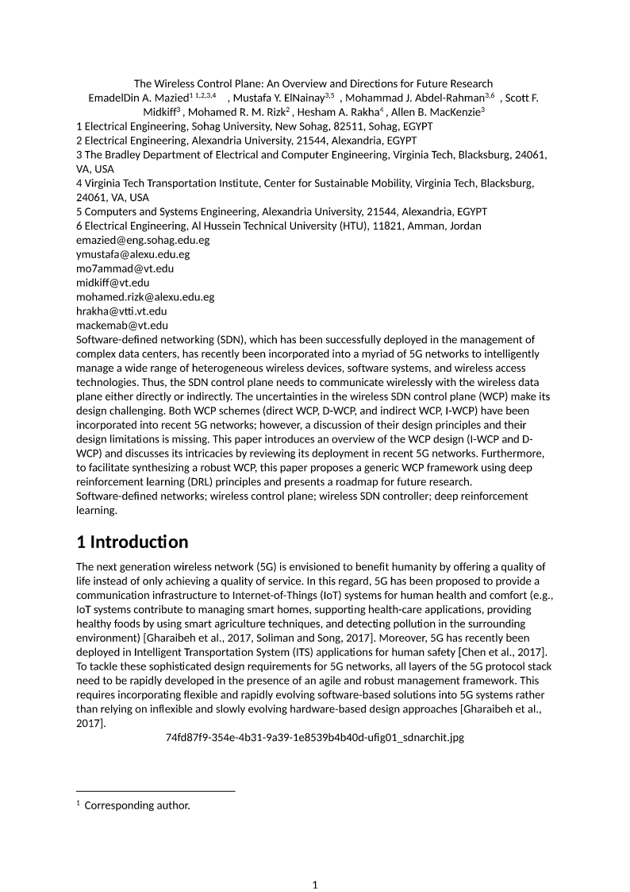

# Расширение LaTeX-импорта после аудита

Рабочее дерево: `D:/projects/StrictLib-mufoed`. Основной каталог библиотеки
`D:/projects/StrictLib` и исходники корпуса не изменялись. Коммит не создавался.
Исходный аудит: [REPORT.md](REPORT.md); первые девять исправлений:
[FIXES.md](FIXES.md).

## Реализовано

| Группа | Реализация | Граница поддержки |
|---|---|---|
| Пользовательские макросы | Параметры `#1`–`#9`, необязательный первый аргумент, def/gdef, команды LaTeX, let, локальные области, шаблоны окружений; в том числе внутри формул | Без исполнения произвольного TeX; delimited def, edef/xdef и низкоуровневые примитивы получают Loss |
| Пакеты | Локальные декларативные `.sty`, зависимости в порядке запроса, загрузка один раз, внутренние имена с `@`, ввод определений из файлов преамбулы | Сложные пакеты с TeX-примитивами целиком получают `package:requires-tex`; их частичное исполнение не меняет штатные команды импортёра |
| Условия | newif, true/false, вложенные логические ветви; невыбранные определения не исполняются | ifnum/ifx и другие вычисляемые условия требуют TeX и явно диагностируются |
| `elsarticle` | Заголовок, все авторы, номера аффилиаций, адреса, email/URL, сноски корреспондирующего автора | Сохраняется содержание, а не точный издательский макет; специальные символы сносок нормализуются в номера |
| Колонки таблиц | Параметризованные newcolumntype, повторения, >{…}/<{…}, шрифтовые декларации, выравнивание и arraybackslash | Произвольная программа в декларации колонок не исполняется; межколоночный материал, неизвестные типы и целевая ширина tabularx имеют явные Loss |
| Ссылки | Кеши прямых и обратных ref/eqref/nameref по собственным счётчикам разделов, формул, рисунков и таблиц; отдельные номера строк align; чтение `.aux` как данных | Кеш страницы из aux относится к предыдущей TeX-вёрстке; это не расчёт страницы Word. Неизвестное значение — `??` и Loss; нестандартные схемы счётчиков и форматы ссылок не полностью вычисляются |
| Библиография | Готовые `.bbl`, bibitem и ссылки вперёд; короткие метки natbib без хвоста полного списка авторов; чтение литеральных полей `.bib` | При импорте bib без bbl используется нормализованный стиль с Loss; произвольные bst/biber, string-выражения, crossref-наследование и точная семантика всех текстовых стилей цитирования остаются неподдержанными |
| TikZ/chemfig | Подключаемый GraphicRenderer; готовый адаптер Tectonic + Poppler; формулы с chemfig также могут становиться изображениями | Требуется явное подключение RenderingSource и доступный TeX-кеш; это рисунки, а не редактируемая геометрия/OMML. Растеризация всегда Loss |
| Ресурсы | Реальное преобразование первой страницы PDF в PNG, ограничения времени/пикселей/байтов, сохранение физического размера по pHYs | Другим неподдержанным контейнерам нужен соответствующий GraphicRenderer; параметры выбора других страниц PDF не реализованы и диагностируются |

**Пункт расширен существенно, но полная совместимость с любыми TeX-пакетами и
ресурсами не заявляется.** Продвинутые случаи остаются явно ограниченными.

## Дополнительные дефекты, найденные при прогоне

- В Metamath частичный разбор vendored `tabu.sty` переопределял команды и
  приводил к рекурсии. Теперь пакет с неподдержанными примитивами отклоняется
  атомарно; документ продолжает обрабатываться с диагностикой пакета.
- В №005 цепочки автоматического математического режима достигали ограничения
  вложенности. В математическом режиме ensuremath — тождественная операция:
  её группы снимаются итеративно, без создания искусственной глубины AST.
  Лимит вложенности не повышался. В текстовом аргументе ensuremath сохраняет
  переход в математику; проверен настоящий индекс внутри такого перехода.
- let-алиасы математических символов теперь сохраняют исходное значение.
- texorpdfstring сохраняет видимую ветвь; альтернативная строка метаданных PDF
  не печатается рядом с ней.
- Параметр размещения рисунка `[!htbp]` больше не становится абзацем.
- Обработаны селекторы первого/второго аргумента и gobble, теги bibinfo/bibfield.
  Служебные имена полей и аннотационные ключи не печатаются вместе с библиографией;
  невыбранные ветви не раскрываются. В предыдущем прогоне фиксировались 1246
  неподдержанных вызовов @secondoftwo.
- В опциональной метке bibitem natbib хвост полного списка авторов больше не
  склеивается с короткой меткой цитирования.

## Проверки

- `cargo +1.92.0 test -p strict-ooxml-latex --offline`: **89 PASS**, 1 внешний тест отключён по умолчанию.
- Отдельный запуск внешнего теста с `--ignored`: **1 PASS**, настоящий Tectonic/Poppler.
- Строгий Clippy `--all-targets -- -D warnings`: **PASS**.
- Повторные тесты MuFoEd: **102 PASS**, 6 ранее отключённых тестов; Release **PASS**.
- Корпус: **100/100 complete**, **0 ошибок**, **0 тайм-аутов**.
- Для **100/100** записанных DOCX проверено отсутствие тихих потерь писателя;
  все документы повторно прочитаны, размещены все **4790 страниц**.
- В главной части документов: **224424 математических выражения**.
- Все 100 документов всё ещё содержат диагностированные потери поддержки:
  **197866 Loss**, **339770 Info**. Подробности ограничены в 9 документах;
  агрегатные счётчики не усечены ни в одном.
- Геометрические сигналы найдены в 19 документах. Это кандидаты проверки границ,
  а не установленное число ошибок и не доказательство визуальной эквивалентности.
- Для @secondoftwo больше нет неподдержанных вызовов: **1246 → 0 Loss**.

Машинные доказательства: [итоги](extended-receipts/totals.json),
[проекты](extended-receipts/cases.csv), [диагностики](extended-receipts/features.csv),
[сравнение с предыдущим этапом](extended-receipts/comparison.csv),
[хеши исходников](extended-receipts/source-hashes.json),
[версия внешнего движка](extended-receipts/external-toolchain.json).
Логи проверок сохранены в `extended-receipts/latex-extended-*.log`.

Полные артефакты текущего прогона:
`D:/projects/StrictLib-mufoed/target/latex-extensions-final-verified-2026-10-18/`.
`index.html` даёт ссылки на DOCX, XML, извлечённый текст, JSON, SVG всех страниц
и до трёх PNG каждого документа. Промежуточные каталоги `latex-extended-*`,
`latex-extensions-verified`, `latex-extensions-final`, `latex-extensions-recheck`
не заменяют этот финальный результат.

Статья №004: **331 абзац, 61 формула, 34 страницы**. В XML главной части
отсутствуют ключи `aff…` и `contrib-…`; сохранены все авторы, шесть адресов,
email-ссылки и сноска корреспондирующего автора. №005: **1973 абзаца, 7630
формул, 123 страницы**. Metamath: **1667 абзацев, 730 формул, 120 страниц**.
Изменение числа страниц/узлов само по себе не является критерием точности.

Реальная проверка внешнего адаптера не подменена mock: Tectonic создаёт TikZ,
chemfig, формулу с chemfig; Poppler преобразует PDF. Проверяется запись DOCX и
физический размер PDF-рисунка 120×60 pt после ограничения растра.
Интеграционный тест требует внешних программ и по умолчанию помечен ignore;
в этой сессии он запускается отдельно с `--ignored` и `only_cached: true`.

Tectonic 0.17.0 для проверок скачан из официального релиза только в
`target/latex-tools/tectonic/`. Кеш пакетов расположен в `target/latex-tools/cache`.
Библиотека не устанавливает и не скачивает движок при обычном импорте.

## Использование и интеграция

Контракт и пример подключения: [README крейта](../../strict-ooxml-latex/README.md).
Нативные исправления доступны через существующий публичный импорт MuFoEd.
Повторная проверка потребителя после завершения параллельных изменений химического
редактора прошла: 102 теста, Release собран. Эти параллельные правки в MuFoEd и
chem-editor не являются изменениями данного этапа LaTeX-импорта. Внешний адаптер TikZ/chemfig/PDF в маршрут импорта
MuFoEd **ещё не подключён**: для него нужно настроить пути программ, кеш и политику
запуска. В готовом приложении из этой сборки эти преобразования автоматически
не включаются. Для проверки самого адаптера предоставляются полученные DOCX/PNG.

Адаптер запускает Tectonic с `--untrusted`, без shell escape; процессы скрыты в
Windows и ограничены по времени. Используется отдельный временный каталог,
разрешение до 4096 px по длинной стороне, контроль размера результата. По
умолчанию в примере разрешён только существующий кеш. Это не утверждение об
изоляции произвольного процесса средствами ОС; такую политику задаёт приложение.

Локальные ресурсы/пакеты исходного проекта не копируются во внешний временный
каталог автоматически. Для таких проектов нужен GraphicRenderer со своей
подготовкой ресурсов. Наличие адаптера не означает успешную компиляцию любого
исходного проекта корпуса настоящим TeX-движком.

## Примеры

[Статья №004 после импорта](extended-evidence/article004-document.docx):

[DOCX с настоящими TikZ и chemfig](extended-evidence/graphics.docx),
[PDF-ресурс после конвертации](extended-evidence/pdf-resource.png).

PNG рисунков в `extended-evidence/graphic-0.png`, `graphic-1.png`, `graphic-2.png`
получены внешним TeX-движком. Проверены изображения стрелки и молекулы,
первая страница №004 и наличие служебных ключей в её XML; проверка выборочная.

Полная сверка всех страниц с эталонным PDF/Word не выполнялась; исходные
ограничения рендера математических сеток из FIXES.md в этом этапе не исправлялись.
