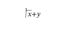
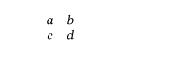

# Результаты исправления LaTeX-импорта

Продолжение поддержки пакетов, макросов и ресурсов: [EXTENSIONS.md](EXTENSIONS.md).

18 октября 2026. Исходный аудит и прежние доказательства сохранены в
[REPORT.md](REPORT.md). Исправления выполнены в предложенном порядке,
в `strict-ooxml-latex` рабочего дерева `D:/projects/StrictLib-mufoed`.
Основной каталог библиотеки и исходный корпус не изменялись. Коммит не создавался.

**Девять дефектов импортёра исправлены; все девять регрессионных тестов активны
и проходят. Общая эквивалентность произвольному LaTeX/Word не заявляется.**

## Выполнено

| Этап | ID | Изменение | Проверка |
|---|---|---|---|
| 1 | AUD-01 | Раздельный учёт фигурных и квадратных групп; диагностика EOF в пропускаемой группе | Статья №004 больше не пустая; некорректный ввод даёт Loss/Reject |
| 2 | AUD-02 | Лексические текстовые фрагменты читаются по математическим атомам; совместимые runs объединяются после привязки индексов | `x_i+y` и `x^2+z` сохраняют `+y`/`+z` вне индексов; проверены Unicode и пробелы |
| 2 | AUD-03 | Необязательная степень радикала ограничивается собственными скобками | `\sqrt[3]{x}+y`: степень `3`, радиканд `x`, хвост `+y` |
| 3 | AUD-06 | Преамбула `array` отделена от ячеек; `l/c/r` и `[t/b/c]` отражаются в стандартных свойствах OMML | `{cc}` не печатается; проверены выравнивание и лимит колонок |
| 3 | AUD-07 | Захват окружений учитывает имена/вложенность; разделители внутренних строк и ячеек не делят внешнюю матрицу | Внешняя ячейка `e` сохранена, проверена структура обеих матриц |
| 4 | AUD-04 | `\label` становится закладкой в абзаце формулы | Проверены `$…$`, `$$…$$`, `\(…\)`, `\[…\]`, `ensuremath`, `align`; запись DOCX без тихих потерь |
| 4 | AUD-05 | Размеры математических отступов и межстрочных зазоров не становятся математическими данными | Проверены `hspace`, небратый `kern`, `\\[2pt]`; неподдержанный размер остаётся явным Loss |
| 4 | AUD-08 | Аргументы настроек длины/счётчиков отделены от текста | `0pt` не печатается; соседняя группа с настоящим текстом сохранена |
| 4 | AUD-09 | Определения макросов пропускаются как определения, без их исполнения и без печати параметров | Проверены `def` и обе формы `newcommand`; содержимое неизвестной текстовой обёртки сохраняется |

При проверке всех способов записи формул дополнительно исправлены закрывающая
пара `$$` и захват внутренних `$…$` внутри фигурной группы: они не должны
создавать лишнюю незакрытую формулу. Не выполняется произвольное исполнение TeX.
Раскрытие пользовательских макросов не добавлялось; неподдержанные вызовы
по-прежнему диагностируются.

Преамбула `array` с расширенным неподдержанным синтаксисом не выводится как
содержимое ячейки, а получает Loss. Это не заявка на поддержку всех типов колонок
пакетов TeX. Стек вложенных математических окружений и метаданные колонок
проверяются по действующим ограничениям импортёра.

## Проверки

- `cargo +1.92.0 test -p strict-ooxml-latex --offline`: **67 PASS, 0 IGNORED**,
  включая 17 регрессий/контрольных проверок в `cc0_regressions.rs`.
- `cargo +1.92.0 clippy -p strict-ooxml-latex --all-targets --offline -- -D warnings`: **PASS**.
- `cargo +1.92.0 test -p mufoed --offline`: **102 PASS**, 6 ранее отключённых
  тестов пропущены. Сборка потребителя импортёра проверена.
- Release `target/release/mufoed.exe` пересобран.
- Полный повторный прогон **100/100** входных проектов: импорт, DOCX, повторное
  чтение, раскладка всех страниц — **PASS**, аварий и тайм-аутов нет.
- `verify_no_silent_loss` писателя: **100/100 PASS**, что по-прежнему не заменяет
  проверку смысловой точности импорта.

Логи и хеши: [fixed-receipts](fixed-receipts/).
[Состояние девяти исправлений](fixed-receipts/remediation.json),
[сравнение по каждому проекту](fixed-receipts/comparison.csv),
[актуальные диагностические категории](fixed-receipts/features.csv).

## Сравнение корпуса

| Наблюдение | До | После |
|---|---:|---:|
| Успешно завершённые проекты | 100 | 100 |
| Страницы раскладки | 3990 | 4931 |
| Абзацы главной части DOCX | 84 116 | 110 138 |
| OMML-выражения главной части | 169 071 | 207 453 |
| Таблицы / рисунки главной части | 193 / 205 | 242 / 237 |
| `math.command:label`, Loss | 2642 | 0 |
| `math.command:hspace`, Loss | 285 | 0 |
| `command:setlength`, Loss | 723 | 0 |
| `command:def`, Loss | 794 | 0 |
| Общие события Loss | 210 289 | 214 261 |
| Проекты с геометрическими кандидатами за границами страницы | 37 | 16 |

Увеличение числа страниц/узлов само по себе не доказывает точность. Исправление
пропуска групп восстановило ранее неразобранные участки нескольких документов;
также изменилась математическая структура и раскладка. Частоты событий нельзя
считать числом независимых дефектов.

Общий Loss не обязан уменьшаться: теперь обрабатывается дополнительное содержимое,
а неподдержанные отступы/зазоры и сложные преамбулы получают явные категории.
Например `math.spacing:hspace` — 277 событий, не скрытое применение отступа.
99 проектов всё ещё содержат потери поддержки; лимит подробностей достигнут
в 7 проектах, агрегатные счётчики сохранены.

Статья №004: **0 → 284 абзаца, 0 → 61 формула, 1 пустая → 32 страницы**,
8 рисунков. Уточнено первоначальное описание: до исправлений рендерер выдавал
одну пустую страницу с колонтитулом, а не ноль страниц; главная часть DOCX
при этом действительно была пустой.

Полные новые артефакты:
`D:/projects/StrictLib-mufoed/target/latex-fixed-2026-10-18/`.
`index.html` содержит обзор, каждый каталог проекта — DOCX/XML/текст/JSON,
SVG всех страниц и до трёх PNG. Исходные артефакты аудита не перезаписаны.

## Визуальные примеры после исправлений

Индексы:

Радикал и массив:

Метка и неподдержанный размер больше не печатаются:

Для каждого из девяти исходных минимальных примеров сохранены новые DOCX,
SVG, PNG и JSON в [fixed-evidence](fixed-evidence/). Проверены также первые
страницы №002 и восстановленной №004. Визуальная проверка остаётся выборочной.

## Что остаётся отдельной работой

1. Пользовательские пакеты/макросы, TikZ/chemfig, сложные преамбулы колонок,
   неподдержанные ресурсы и вычисление ссылок/библиографии. Эти ограничения
   не устранены заменой служебных аргументов. Например в восстановленной статье
   №004 остаются ключи аффилиаций из разметки неподдержанного класса `elsarticle`.
2. Полнота визуальной поддержки математических сеток в `strict-ooxml-render-svg`.
   Во вложенной матрице ячейка `e` теперь есть в правильной внешней ячейке OMML,
   но на PNG её вертикальное положение требует отдельного исправления.
   В №002 на первой странице также остаются наложения строк формул.
   В `Grid::place` (`math/layout.rs`) для display-сеток явно сохранён прежний
   номинальный способ размещения ячеек. Импортёр не подгонялся под это поведение;
   рендерер в данном изменении не редактировался.
3. Независимая сверка с PDF, полученным настоящим TeX-движком, и проверка
   в Word/WPS. Полная визуальная аттестация корпуса не выполнялась.

Итог: закрыты девять воспроизводимых дефектов импорта. Отдельные ошибки
раскладки и широкая поддержка сторонних TeX-пакетов не объявляются исправленными.
