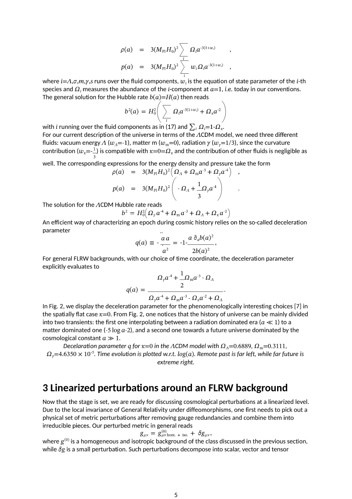
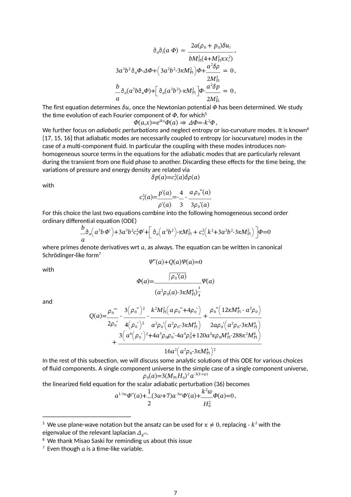

# Наложения и повторы в формулах: документ 023

2026-10-18. Согласованная правка `strict-ooxml-render-svg` в рабочем дереве.
Основной `D:/projects/StrictLib` и параллельные изменения MuFoEd не изменялись.

## Причины и исправление

**Страница 5.** Отдельные ячейки отображаемой математической таблицы сдвигались
относительно базовой линии по собственной высоте. Дробь во второй строке
поднимала соседние скалярные ячейки к первой строке. Теперь у ячеек строки
общая базовая линия. При выборе следующей базовой линии учитываются нижняя
часть текущей строки и верхняя часть следующей, а также заданный шаг строк.
В проблемном блоке расстояние между базовыми линиями rho(a) и p(a):
**6.084 → 37.473 px**.

**Страница 7.** `m:eqArr` делился на ячейки после отрисовки: каждый интервал
выравнивания получал копию всей строки, рассчитанную на дальнейшую обрезку.
Это размножало текстовые элементы и приводило к видимым повторам.
Теперь `m:aln` и разделители амперсанда разбивают содержимое на ячейки до
расчёта их геометрии. Каждое выражение рисуется один раз, пустые начальные
ячейки сохраняются. Литерал амперсанда остаётся текстом. Сохранены свойства
аргументов, обработка видимых результатов полей и лимит точек выравнивания.

## Регрессии

Добавлены **пять** переносимых проверок без внешнего корпуса и TeX-движка:

1. Реальный блок со страницы 5: общая базовая линия скалярных и высоких ячеек,
   достаточное расстояние между строками.
2. Реальный блок со страницы 7: шесть знаков частной производной в исходных
   трёх строках дают шесть нарисованных знаков. Прежний renderer давал 18.
3. Пустые начальные ячейки, строка с амперсандом и дробь: содержимое не повторяется,
   ячейки расположены в разных столбцах и строках.
4. Литеральный амперсанд не становится границей ячейки.
5. Проверка геометрии общей сетки: строка с большой нижней частью и следующая
   строка с большой верхней частью не пересекаются.

Два теста на документе 023 воспроизвели дефекты до исправления; новые проверки
включены в обычный запуск и не помечены ignore.

```powershell
cargo +1.92.0 test -p strict-ooxml-render-svg --offline --lib --test math
cargo +1.92.0 clippy -p strict-ooxml-render-svg --all-targets --offline -- -D warnings
```

Результат: **117 модульных + 41 математический интеграционный тест PASS**,
Clippy PASS. [Лог тестов](grid-fix-evidence/latex023-after-fix-tests.log),
[Clippy](grid-fix-evidence/latex023-clippy.log),
[числа и хеши исходников](grid-fix-evidence/status.json).

## Проверка документа

Документ 023 заново импортирован, записан, прочитан и отрисован целиком:
**22 страницы**, stage=complete, writer_no_silent_loss=true.
`word/document.xml` побайтно совпадает с предыдущим результатом: исправляется
отрисовка, а не содержимое формул. Пятая и седьмая страницы просмотрены в PNG.

[DOCX](grid-fix-evidence/document.docx),
[результат конвейера](grid-fix-evidence/result.json).
Полные SVG находятся в `target/latex023-grid-fixed-2026-10-18/`.
Для повторного создания PNG любой сохранённой страницы инструмент поддерживает
`latex-audit --raster INPUT.svg OUTPUT.png` с теми же встроенными шрифтами.

| Страница | До | После |
|---|---|---|
| 5 | [PNG](grid-fix-evidence/before-page-5.png) | [PNG](grid-fix-evidence/page-5.png) |
| 7 | [PNG](grid-fix-evidence/before-page-7.png) | [PNG](grid-fix-evidence/page-7.png) |





Область проверки этого этапа — классы ошибок математической сетки и документ
023. Сохраняются ранее диагностированные ограничения импортёра и предупреждения
о других широких формулах/строках; полная визуальная эквивалентность TeX не заявляется.
