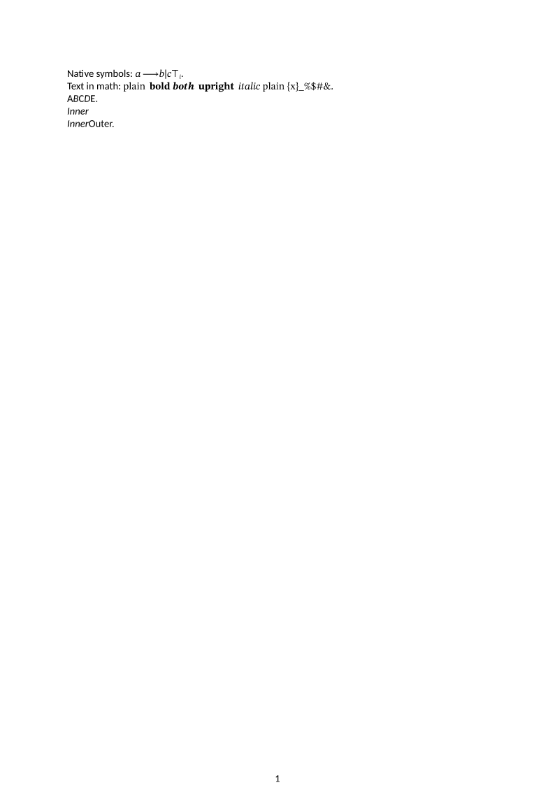

# LaTeX: небольшие нативные команды и локальные группы

Дата: 2026-10-18. Изменения выполнены в рабочем дереве
`D:/projects/StrictLib-mufoed`. Согласованы пункты 1–3 и отдельное исправление
жирности/курсива нормального текста в `strict-ooxml-render-svg`.

## Реализовано

1. `\textunderscore`, декларация `\em`, математические длинные стрелки
   `\longrightarrow`, `\longleftarrow`, `\longleftrightarrow`, символы `\mid`
   и `\top`. Сохранено связывание индексов с одним математическим атомом;
   пробел-разделитель после новых текстовых команд не становится содержимым.
2. Внутри математического `\text{…}` разбираются вложенные группы,
   `\textbf`, `\textit`, `\textup`, `\textnormal`, `\emph` и декларации
   жирности/курсива. Сохраняются Unicode, обычные и неразрывные пробелы,
   экранированные символы и вложенные `$…$` / `\ensuremath`. Неизвестные
   команды получают Loss, а их имена не печатаются как текст документа.
   Свойства нормального текста записываются в стандартный `w:rPr`.
3. `\begingroup` / `\endgroup` восстанавливают локальные макросы,
   логические переменные, форматирование, цвета, пути рисунков, определения
   колонок и окружений. Поддержаны вложенность, несколько абзацев, преамбула
   и включённые файлы; `\gdef` сохраняется после выхода. Настройки окружений
   также локальны. Непарные группы диагностируются, глубина ограничена.
4. В render-svg нормальный текст `m:nor` учитывает прямые `w:b` / `w:i`
   при измерении и отрисовке. Математические начертания `m:sty` продолжают
   применяться к математическим символам по прежним правилам. Добавлены
   проверки четырёх сочетаний жирности/курсива и расстояния до следующего атома.

## Проверки

- 13 новых переносимых регрессий импортёра: `tests/small_commands.rs`.
- Две новые регрессии отрисовки: `strict-ooxml-render-svg/tests/math.rs`.
- Все тесты LaTeX-импортёра: 102 PASS, один внешний интеграционный тест
  по умолчанию ignored; в этом этапе внешний TeX-движок не запускался.
- Математическая отрисовка: 37 PASS.
- Clippy обоих крейтов, все targets, `-D warnings`: PASS.
- Логи и хеши изменённых исходников: [small-commands-receipts](small-commands-receipts/).

## Контрольный пример

[DOCX](small-commands-evidence/document.docx),
[исходный LaTeX](small-commands-evidence/source.tex),
[SVG](small-commands-evidence/page-1.svg),
[результат выполнения](small-commands-evidence/result.json).

Контрольная страница просмотрена: есть жирный, курсивный и комбинированный
текст в формуле; локальное начертание и макрос восстанавливаются после группы.

Это ограниченное расширение нативного импорта. Полное выполнение TeX,
неподдержанные пакеты и издательская вёрстка сохраняют прежние ограничения.
Проверка всего корпуса является проверкой конвейера, а не доказательством
визуальной эквивалентности каждой страницы эталонному TeX/PDF/Word.

## Повторный прогон CC0_TEX

Окончательные полные артефакты:
`D:/projects/StrictLib-mufoed/target/latex-small-commands-final-2026-10-18/`.
Предварительный `target/latex-small-commands-2026-10-18/` не является
окончательным результатом: он получен до правки свойств обычного текста.

- **100/100 complete**, ошибок процессов и тайм-аутов нет.
- Проверка writer `verify_no_silent_loss`: **100/100 PASS**.
- Отрисованы все **4748 страниц**, сохранены SVG; первые три страницы каждого
  документа также сохранены в PNG.
- Loss: **197866 → 187261**, Info: **339770 → 338998**.
- Формул в главной части: **224424 → 224428**. Изменение числа узлов и страниц
  не является самостоятельным признаком улучшения или ухудшения точности.
- Потенциальные выходы за границы страниц: 19 → 15 документов. Это эвристика,
  а не проверка наложений или точности геометрии формул.
- Детальные диагностики достигли лимита в восьми документах; агрегированные
  счётчики feature_counts не усечены. Все 100 документов сохраняют Loss.

| Прежняя диагностика | До | После |
|---|---:|---:|
| `command:textunderscore` | 3595 | 0 |
| `command:em` | 1534 | 0 |
| `command:begingroup` | 2768 | 0 |
| `command:endgroup` | 2768 | 0 |
| `math.command:longrightarrow` | 1068 | 0 |
| `math.command:longleftarrow` | 19 | 0 |
| `math.command:longleftrightarrow` | 18 | 0 |
| `math.command:mid` | 856 | 0 |
| `math.command:top` | 782 | 0 |
| `math.command:protect` | 2825 | 0 |
| `math.command:textit` | 527 | 0 |
| `math.command:textup` | 922 | 0 |
| `math.command:textbf` | 522 | 0 |

Снижение старых счётчиков не складывается напрямую в общее снижение Loss:
появились новые точные `math.text.*` диагностики, поскольку ранее неизвестные
команды внутри текстовых частей формул вообще не разбирались и печатались
сырой разметкой. Среди оставшегося неподдержанного содержимого — рисунки,
raisebox, отдельные математические/шрифтовые команды и ссылки внутри этих
текстовых частей. Их поддержка не заявляется этим этапом.

[Итоги](small-commands-receipts/totals.json),
[случаи](small-commands-receipts/cases.csv),
[диагностики](small-commands-receipts/features.csv),
[сравнение](small-commands-receipts/comparison.csv),
[статус проверок](small-commands-receipts/status.json).
