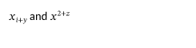
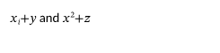
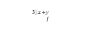
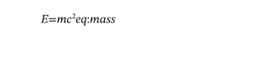
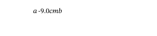
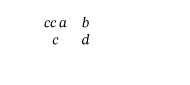
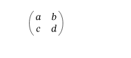
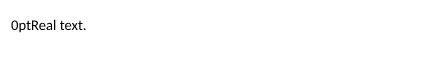

# Аудит LaTeX-импорта на CC0_TEX

Дата: 18 октября 2026. **Проверка корректности содержимого и формул НЕ ПРОЙДЕНА.**

Состояние до исправлений. Актуальный результат устранения дефектов: [FIXES.md](FIXES.md).

Конвейер технически обрабатывает корпус, но успешное создание и открытие DOCX
не означает сохранение математического смысла. Подтверждены **9 дефектов**:
**1 P0, 6 P1, 2 P2**. Один исходник превращается в пустой документ без потерь
в отчёте; несколько поддерживаемых математических конструкций искажаются
также без диагностик потерь.

## 1. Объём и воспроизводимость

- Код: `D:/projects/StrictLib-mufoed`, HEAD `cfd92769280e5876d69365feed753aa83c3097a7`.
- Корпус: `D:/projects/StrictLib/testdata/CC0_TEX`, восемь манифестов, **100 входных проектов**.
- Все 100 `main_tex_in_project` существуют; SHA-256 каждого совпал с `sha256`
  соответствующей записи манифеста. Состояние рабочего дерева, хеши манифестов,
  входов и исполняемого файла сохранены в [inventory.json](inventory.json).
- Инвентаризирован **871 `.tex`**: это также копии в `files/`, главы и вспомогательные
  исходники. Они не объявляются 871 независимым успешно импортированным документом.
- Импорт: `strict_ooxml_latex::import_file`, стандартные `LatexOptions` и ограничения.
  Дополнительные файлы разрешаются стандартным `FsSource`; фактически подключено 152 файла.
- Запись: `write_package` с исходными импортированными ресурсами; затем повторное
  открытие через `StrictDocument::open_reader` и раскладка **всех страниц**.
- Отрисовка: штатный SVG-рендерер, стандартные параметры и встроенные шрифты;
  PNG получены через resvg с теми же программами шрифтов. Системные шрифты не подмешиваются.
- Каждый проект запускается в отдельном процессе со стеком 64 MiB и тайм-аутом 90 секунд.
- Корпус, команды TeX, скрипты из проектов и внешние приложения не исполнялись.
  Исходники реализации StrictLib не изменялись. В крейт добавлен только тестовый файл.

Снимок исходников проверяемого импортёра: [source-hashes.json](source-hashes.json).
В рабочем дереве были посторонние незавершённые изменения MuFoEd/chem-editor;
они не включались в предмет аудита и не исправлялись.

## 2. Результаты конвейера

| Проверка | Результат | Что это доказывает |
|---|---:|---|
| Импорт, запись DOCX, повторное чтение | 100/100 PASS | Конвейер завершается на входах корпуса |
| Тайм-ауты, аварийные завершения | 0 | В выполненном прогоне не наблюдались |
| Раскладка и SVG всех страниц | 3990 страниц, 100/100 PASS | Рендерер принимает полученную модель |
| `writer.verify_no_silent_loss()` | 100/100 PASS | Проверка писателя; не проверка смысловой точности LaTeX-импорта |
| Входы с потерями импорта | 99/100 | Единственный вход без потерь оказался пустым документом |
| События Loss / Info | 210 289 / 53 407 | Повторные события, **не** количество независимых дефектов |
| Превышен лимит деталей диагностик | 6 документов | Агрегатные счётчики сохранены; подробности не исчерпывающие |
| Лимит агрегатных категорий | Не достигнут | Сумма агрегатов Loss совпадает с общим счётчиком |
| OMML-выражения в главной части DOCX | 169 071 | Наличие узлов, не доказательство их эквивалентности TeX |
| Абзацы / таблицы / рисунки главной части | 84 116 / 193 / 205 | Статистика результата; не коэффициент сохранности исходника |
| Правильность текста и математики | **FAIL** | Ниже приведены воспроизводимые контрпримеры |

Подробно: [cases.csv](cases.csv), [features.csv](features.csv), [totals.json](totals.json).

## 3. Подтверждённые дефекты

Приоритеты: **P0** — массовая/полная тихая потеря; **P1** — изменение смысла
формулы или загрязнение математического содержимого; **P2** — утечка служебного
текста при явно неполной поддержке команды. Приоритет не означает частоту.

| ID | Приоритет | Класс | Минимальное проявление | Диагностика потерь на примере |
|---|---|---|---|---|
| LATEX-AUD-01 | P0 | Потеря документа, разбор групп | `[` внутри `{...}` преамбулы поглощает весь документ | 0 |
| LATEX-AUD-02 | P1 | Связывание математических атомов | `x_i+y` превращается в `x_{i+y}`; `x^2+z` — в `x^{2+z}` | 0 |
| LATEX-AUD-03 | P1 | Структура радикала | `\sqrt[3]{x}+y`: степень `3]x+y`, подкоренное выражение пустое | 0 |
| LATEX-AUD-04 | P1 | Метаданные в формуле | `\label{eq:mass}` печатает `eq:mass` после формулы | 1 |
| LATEX-AUD-05 | P1 | Аргументы разметки в формуле | `a\hspace{-9.0cm}b` печатает `a-9.0cmb` | 1 |
| LATEX-AUD-06 | P1 | Разбор математического массива | `{cc}` в `array` попадает в первую ячейку перед `a` | 0 |
| LATEX-AUD-07 | P1 | Вложенные окружения | После вложенной `matrix` пропадает внешняя ячейка `e` | 0 |
| LATEX-AUD-08 | P2 | Настройки в обычном тексте | `\setlength{\parindent}{0pt}` печатает `0pt` | 2 |
| LATEX-AUD-09 | P2 | Определения макросов в тексте | `\def\foo#1{#1}` печатает `#1#1` | 2 |

### LATEX-AUD-01 — пустая статья с нулевым Loss

Корпус: `part1/projects/004_1810.03670/article.tex`, строка 124:

```tex
\AtBeginDocument{\def\includegraphics{\@ifnextchar[{\ts@includegraphics}{\ts@includegraphics[width=\checkGraphicsWidth,height=\checkGraphicsHeight,keepaspectratio]}}}
```

Исходник содержит 116 976 Unicode-символов и `\begin{document}` в строке 171.
В результате **0 абзацев, 0 формул, 1 пустая страница с колонтитулом, loss_count = 0**.
Свёрнутый пример с синтаксически допустимым литералом `[`:

```tex
\documentclass{article}
\AtBeginDocument{\def\openbracket{[}}
\begin{document}BODY\end{document}
```

`BODY` исчезает. Замена литерала `[` на `(` сохраняет `BODY` — положительный контроль.
Причина: `parser.rs:545`, `skip_balanced` считает `{` и `[` одинаковыми
открывающими, а `}` и `]` одинаковыми закрывающими разделителями. Литерал `[`
внутри фигурной группы создаёт незакрытую «глубину», и пропуск продолжается до EOF.
EOF в таком пропуске не превращается в Loss/ошибку.

Доказательства: [вход](evidence/preamble.tex), [DOCX](evidence/preamble-document.docx),
[XML](evidence/preamble-document.xml), [JSON](evidence/preamble-result.json).

### LATEX-AUD-02 — неверная граница индекса и степени

```tex
$x_i+y$ and $x^2+z$
```

В OMML записываются `<m:sub>...i+y...</m:sub>` и `<m:sup>...2+z...</m:sup>`.
В TeX небратый в фигурные скобки аргумент индекса/степени здесь — один символ.
Причина: `math.rs:409`, `parse_argument`, совместно с `parse_atom_inner`:
лексический `Text` принимается целиком как один математический атом.
Это затрагивает также аналогичные небратые аргументы других конструкций;
полный перечень последствий в этом аудите не устанавливался.

Конкретный вход корпуса: №001 `root.tex:707`, `|p_i-g_i|`.
Точное число испорченных выражений в 169 071 узлах не подсчитывалось.

Получено:



Контроль с эквивалентной явной группировкой `$x_{i}+y$ and $x^{2}+z$`:



[Вход](evidence/script.tex), [XML](evidence/script-document.xml).

### LATEX-AUD-03 — корень с указанием степени

```tex
$\sqrt[3]{x}+y$
```

`m:deg` содержит `3]x+y`, `m:e` пустой. Результат не эквивалентен исходной
формуле. Причина: `math.rs:593`, `radical` читает степень через
`parse_sequence`, чей `is_stop` не останавливается на `RBracket`.
Стандартный `\sqrt{x}` проходит положительный контроль.

Пример корпуса: №019 `disorderedV11.tex`, выражение `\sqrt[3]` около строки 818;
точное имя входа и хеш доступны в [cases.csv](cases.csv) и [inventory.json](inventory.json).
Поиск по главным файлам находит `\sqrt[` в 7 проектах; это **кандидаты по исходникам**,
включая возможные комментарии и определения, не число доказанных повреждений.



[Вход](evidence/sqrt.tex), [XML](evidence/sqrt-document.xml).

### LATEX-AUD-04 и 05 — служебные аргументы становятся математическими данными

```tex
\[E=mc^2\label{eq:mass}\]
\[a\hspace{-9.0cm}b\]
```




Причина: `math.rs:507`, неизвестная математическая команда получает Loss,
но оставшийся аргумент снова разбирается как обычная математическая группа.
Для `label` требуется также корректная привязка метки, а не только удаление видимого ключа.

В корпусе: `math.command:label` — **2642 события в 50 входах**;
`math.command:hspace` — **285 событий в 9 входах**. Это точные частоты диагностик,
не поэлементная визуальная проверка каждого события. №002, `orthosym.tex:375–379`,
содержит реальные `\hspace{-9.0cm}`; на первой странице результата видны размеры
и наложение строк. Наличие исходного отрицательного отступа отдельно не доказывает
ошибку самого SVG-рендерера.

[label: вход](evidence/label.tex), [XML](evidence/label-document.xml);
[hspace: вход](evidence/hspace.tex), [XML](evidence/hspace-document.xml).

### LATEX-AUD-06 — спецификация колонок array печатается в ячейке

```tex
$\begin{array}{cc}a&b\\c&d\end{array}$
```

Первая ячейка содержит `cca`, а не `a`; `loss_count = 0`.
Причина: `math.rs:107`, `translate_environment` строит матрицу из всего тела,
не отделяя преамбулу колонок `{cc}`. Вложенный путь `math_environment` также
передаёт эту группу как содержимое.
Пример исходника корпуса: №005, `thesis.tex:320`, `\begin{array}{lllll}`.



[Вход](evidence/array.tex), [XML](evidence/array-document.xml).

### LATEX-AUD-07 — вложенное окружение обрывает внешнее

```tex
$\begin{pmatrix}\begin{matrix}a&b\\c&d\end{matrix}&e\end{pmatrix}$
```

Ячейка `e` отсутствует; `loss_count = 0`.
Причина: `math.rs:914`, `math_environment` захватывает токены до первого
`\end`, без стека имён и глубины вложенности. Разделение строк/ячеек также
требует учёта вложенных окружений. Контрпример воспроизводится автономно;
частота этого конкретного дефекта в корпусе не измерялась.



[Вход](evidence/nested.tex), [XML](evidence/nested-document.xml).

### LATEX-AUD-08 и 09 — служебные команды загрязняют обычный текст

```tex
\setlength{\parindent}{0pt}Real text.
\def\foo#1{#1}Real text.
```




Причина: `parser.rs:1150`, fallback неизвестной текстовой команды сохраняет
первую фигурную группу как текст, а прочие токены продолжают читаться обычным
путём. Это полезно для неизвестной команды оформления вокруг текста, но
неправильно для определений и настроек. Нельзя исправлять это безусловным
удалением аргументов всех неизвестных команд: так будет теряться настоящий текст.

В корпусе: `command:setlength` — **723 события в 21 входе**,
`command:def` — **794 события в 14 входах**. Явное загрязнение видно на первых
страницах №059, №064 и №100: параметры `#1`, `#2`, имена настроек, служебные
присваивания и код шаблонов. Полный перечень видимых утечек по всему корпусу
автоматически не аттестован.

[Настройка: вход](evidence/config.tex), [XML](evidence/config-document.xml);
[определение: вход](evidence/defbody.tex), [XML](evidence/defbody-document.xml).

## 4. Ограничения поддержки, отдельно от девяти дефектов

| Класс | Наблюдение | Оценка |
|---|---|---|
| Пользовательские макросы и пакеты | Например `\RR` из `\newcommand` не раскрывается; `x\in\RR` теряет `R`, есть Loss | Ограничение импортёра, не отдельный дефект по каждому имени макроса |
| TikZ / PGF / chemfig / mhchem и подобные DSL | Схемы/химия не становятся полноценными объектами; могут остаться аргументы | Неподдержанные конструкции; часть утечек относится к AUD-08/09 |
| Рисунки PDF/EPS и отсутствующие ресурсы | 190 событий `image:unsupported-container:*`, 225 `image:not-found:*` | Явные Loss. `not-found` не доказывает отсутствие файла в архиве: важны расширения, относительные пути и контекст provider |
| Включаемые файлы | 138 событий `include:*` с потерями | Требуют раздельной проверки пути/границы источника; не объявлены 138 багами |
| Ссылки и библиография | Кэш REF/PAGEREF содержит ключ вроде `sec:intro`, цитата — `[paper2020]`; 7613 Info для cross-reference, 2615 Info для citation | Семантическая/редакторская неполнота. Наличие поля не означает вычисленное значение и корректную нумерацию |
| Сложные таблицы и обёртки | №001 содержит таблицы под неподдерживаемыми командами; в главной части результата таблиц 0 | Ограничение взаимодействия с неподдерживаемой обёрткой; таблицы простого поддерживаемого вида не следует объявлять сломанными без отдельной проверки |

Масштаб потерь по префиксам диагностик: `command:` 98 274, `math.` 76 724,
`text:` 26 829, `environment:` 4545, `alignment:` 3158, `image:` 415,
`include:` 138. Эти группы не описывают все возможные префиксы и не являются
взаимозаменяемыми с числом дефектов или удалённых символов.

## 5. Проверка рендера и границы доказательств

- Все 3990 страниц раскладывались и сохранялись как SVG. Для каждого документа
  растеризованы первые три страницы либо все страницы, если их меньше трёх.
- Вручную просмотрены **6 страниц корпуса**: №001 стр. 3; №002, №059, №064,
  №078, №100 стр. 1. Просмотрены **10 изображений/фрагментов минимальных примеров**:
  align, script, script-correct, sqrt, array, nested, label, hspace, config, defbody.
  Это выборочная проверка, не визуальная аттестация всего корпуса.
- Простой двухстрочный `align` является положительным визуальным контролем;
  нормальные строки не накладываются. В №001 сохранённый PNG-рисунок виден корректно
  на проверенной странице. Это не доказывает полноту переноса всех изображений.
- Проверка границ текста применяет все матрицы родительских `GroupItem`, затем
  проверяет конечные точки базовой линии в координатах страницы. Она даёт
  **сигналы для проверки**, а не число доказанных ошибок верстки. Клиппинг,
  контуры глифов, взаимные перекрытия и эквивалентность формул этим не проверяются.
  Подробности и актуальные количества находятся в `totals.json` и `cases.csv`.
  В итоговом прогоне сигналы за границами страницы найдены в **37 документах**:
  47 935 фрагментов базовых линий до ограничения сохраняемых примеров.
  Это не 47 935 независимых дефектов и не классификация причины каждого случая.
- Начальный вариант инструмента ошибочно проверял локальные координаты дочерних
  примитивов. Он исправлен, добавлен тест композиции матриц, выполнен новый полный
  прогон. Старые каталоги `target/latex-audit-full-2026-10-18` и
  `target/latex-audit-2026-10-18` не являются итоговыми геометрическими доказательствами.
- Не выполнялись: независимая перекомпиляция корпуса TeX-движком, постраничное
  сравнение с эталонными PDF, проверка в Microsoft Word/WPS и всех установленных
  шрифтах. `compile_status` манифестов — исторические метаданные, не наш результат.
- Основная причина показанных неверных формул уже видна в OMML до рендера.
  Перекладывать AUD-02–07 на SVG-рендерер без дополнительной проверки неправильно.

Итоговые полные артефакты:
`D:/projects/StrictLib-mufoed/target/latex-audit-verified-2026-10-18/`.
Внутри каждого case: `result.json`, `document.docx`, `document.xml`, `text.txt`,
`math.txt`, все `page-N.svg`, до трёх `page-N.png`, stdout/stderr процесса.
Обзор: `index.html` в этом каталоге. Большие артефакты находятся в `target/` и
не добавляются в Git; сокращённые доказательства этого отчёта лежат в `evidence/`.

## 6. Тесты и воспроизведение

[Тестовый файл](../../../strict-ooxml-latex/tests/cc0_regressions.rs) не зависит от корпуса.
Обычный прогон: **52 PASS, 9 IGNORED**, включая два новых положительных контроля.
Отдельный явный запуск известных регрессий: **9 FAIL**, каждый по ожидаемому
контракту, а не тестом, принимающим ошибочный результат за норму.
Проверка композиции матриц клиента аудита: **1 PASS**.

```powershell
$env:TEMP='D:/projects/StrictLib-mufoed/target/test-temp'
$env:TMP=$env:TEMP
cargo +1.92.0 test -p strict-ooxml-latex --offline
cargo +1.92.0 test -p strict-ooxml-latex --offline --test cc0_regressions -- --ignored
```

Второй запуск сейчас должен завершиться ошибкой. После общего исправления
соответствующей причины `ignore` снимается с её теста.
Логи: [обычные тесты](latex-final-tests.log), [девять сбоев](latex-known-regressions.log).
Инструмент: [tools/latex-audit](../../../tools/latex-audit/README.md).

## 7. Предлагаемый порядок исправлений

1. AUD-01: разделить фигурные/квадратные группы и диагностировать неожиданный EOF.
2. AUD-02/03: исправить границы математических атомов и необязательных аргументов;
   закрепить эквивалентность явно сгруппированным формулам.
3. AUD-06/07: разбирать преамбулы массивов и вложенные окружения с учётом грамматики.
4. AUD-04/05/08/09: отделить математические данные, метаданные и аргументы настроек;
   сохранять явный Loss для неподдержанного смысла, не выводить служебный код.
5. Затем независимо оценивать раскрытие ограниченного набора макросов, библиографию,
   ресурсы, сложные пакеты и качество макета на согласованном эталонном наборе.

Это общие исправления грамматики и контрактов, без подгонки под имена файлов,
названия статей, конкретные ключи меток или решения MuFoEd. Реализация этих
исправлений в настоящую проверку не включалась; коммит не создавался.
