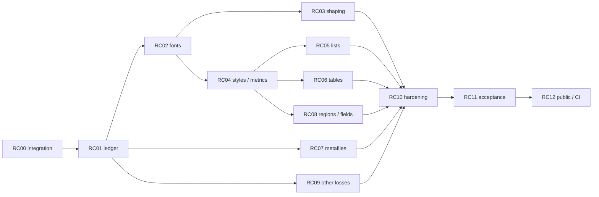

# План оставшейся совместимости RTF

Дата: 7 октября 2026. Историческая база RTF: `a7b3c9f`, ветка `codex/rtf-import`.
Текущий интеграционный baseline: ветка `codex/rtf-import-integrated`, HEAD `5cccef4`
(merge `master` `956948f` от 8 октября; см. «RC00: повторная интеграция master»); подробности и ограничения — в [RC00_INTEGRATION.md](RC00_INTEGRATION.md).
Карточки остаются планом; RC00/RC01 частично закрыты, RC02 font-инфраструктура завершена, приёмка Blocked на внешнем harness. Таблица ниже — исторический снимок 5 октября и не описывает новый прогон.
## Цель и исходное состояние

Цель — закрыть совместимость пользовательского корпуса из 100 RTF по содержимому,
структуре и отображению через публичный импорт. Приёмка поддержанного профиля
R07 и интеграция R08 рассматриваются отдельно. Наличие документированного
unsupported элемента позволяет объяснить Degraded, но не закрывает полную
совместимость документа с этим элементом.

Основание: [ACCEPTANCE.md](ACCEPTANCE.md),
[acceptance.development.json](acceptance.development.json),
[структурные probes](structure.wps-comparison.json).
Полная очередь документов: [compatibility.backlog.json](compatibility.backlog.json).

| Проверка снимка `a7b3c9f` | Результат |
| --- | --- |
| Import / exact body text / text+media roundtrip | 100/100 |
| Media parts, сохранённые побайтно | 38 |
| Strict XSD / OPC | 100/100, 0 violations |
| Пагинация WPS | 61 Pass, 39 Fail |
| Pixel gate документов | 2 Pass, 98 Fail |
| Страницы с установленным соответствием | 244; 7 Pass, 237 Fail |
| PDF report | 48 Clean, 52 Degraded |
| `pdf.font.missing` | 47 документов, 53 различных labels family |
| `pdf.font.no_glyph` | 6 документов |
| `pdf.image.unsupported` | 3 документа: 001, 004, 006 |

Категории пересекаются: 50 документов имеют font/glyph diagnostics, 52 — хотя бы
одну из трёх PDF diagnostics. У 28 из 39 pagination failures есть
`pdf.font.missing`; это корреляция, а не доказательство причины. Все 100 import
reports остаются Degraded. Body equality не проверяет notes/comments/revisions.

Два pixel PASS (040, 046) сохраняются как положительные controls; они не означают
полную совместимость всех свойств этих документов.

## Общие контракты и правила

Источники RTF и raw WPS references неизменяемы. Каждая карточка получает минимальный
synthetic fixture, независимый reference, воспроизводимый RED, исправление,
GREEN и отрицательный контроль. Изменения serialization сравниваются по смыслу
с разрешением IDs/relationships; отсутствующее свойство не считается равным
выведенному по догадке. WPS quirk отделяется от корректного сохранения RTF.

Базовые gates сохраняются: знаменатель 100, точный текст, hashes media,
Strict/OPC, CLI 0/1/2, отсутствие silent loss, bounded reports. Нельзя автоматически
назначать observed FAIL ожидаемым результатом, отключать неизвестные schema
violations, улучшать SSIM resizing/blur или повышением порога допустимой ошибки.

Новый render contract должен включать diagnostics SVG/layout, а не только PDF.
Clean возможен только при выполнении заявленного mapping/coverage. Фактический
fallback получает Degraded и provenance даже при визуально похожем результате.

Runtime строит WML и использует единые writer/renderers. WPS остаётся oracle;
не вводится конвертация через офисное приложение, OCR или PDF в runtime.
Для сложных конструкций расширяется общая модель с проверками всех потребителей;
скрытые XML fragments не подменяют недостающий контракт.

## Интеграция с другими работами

Основной checkout на момент интеграции: `ac51b68`. RTF-интеграция собрана отдельной историей поверх него; цепочка и конфликты описаны в [RC00_INTEGRATION.md](RC00_INTEGRATION.md). Интегрированная база содержит shaping и shared resolved faces вместе с существующими P5 run/paragraph metrics и P6 table widths. Статусы другого корпуса не принимаются за доказательство RTF совместимости.

Граф `D-projects-StrictLib` относится к основному checkout, а не RTF worktree. Для существовавших файлов graph coverage показал изменившиеся метаданные; новые RTF файлы в индексе отсутствовали. Поэтому текущие выводы проверялись непосредственно по исходникам и тестам.

Работа ведётся в отдельном worktree `C:\Users\gamer\.codex\worktrees\rtf-import-integrated\StrictLib`. RC00 включал только зафиксированные RTF изменения; незакоммиченные файлы иных очередей не переносились. Изменения общих model/font/layout/writer контрактов требуют согласованной единой реализации. Коммиты остаются в отдельной ветке и не означают merge в основную ветку.
## Очередь и зависимости

| ID | Приоритет | Пакет / область ответственности | Зависимости |
| --- | --- | --- | --- |
| RC00 | P0 | Интеграция и новый baseline; manifests, shared core/render/write | — |
| RC01 | P0 | Точная диагностика и ledger; PDF report, RTF harness/oracles | RC00 |
| RC02 | P0 | Единое разрешение fonts; shared font code и PDF embedding; associated-script mapping | RC00, RC01 |
| RC03 | P1 | Complex shaping, bidi, glyph clusters; renderer + RTF language mapping | RC02 |
| RC04 | P1 | Styles и paragraph/run geometry; RTF mapping + shared P5 | RC01, RC02 |
| RC05 | P1 | Numbering/lists; RTF lists, WML numbering, writer/layout | RC04 |
| RC06 | P1 | Tables; RTF builder + shared P6/layout/writer | RC04 |
| RC07 | P1 | WMF/EMF и picture properties; shared media/render pipeline | RC00, RC01 |
| RC08 | P1 | Sections/regions/notes/fields; RTF + WML/reader/writer/layout | RC01, RC04 |
| RC09 | P2 | Остальные loss classes; RTF mapping и необходимые shared types | RC01; RC08 для fields/revisions |
| RC10 | P1 | Hostile/resource/determinism gates; все новые декодеры и builders | Каждый реализованный RC02–RC09 |
| RC11 | P1 | Corpus/profile acceptance; independent facts, thresholds, receipts | RC02–RC10 |
| RC12 | P1 | Public feature matrix, CI и release integration | RC11 |

### RC00 — интеграция и воспроизводимый baseline

Сначала сравнить уже закрытые shared changes с RTF исправлениями: core pipeline,
list writer ordering, PDF CIDSystemInfo/CMap/FontBBox/aliases, model props,
resolved faces, shaping и DrawingML geometry. Для каждого совпадения определить
единственную реализацию и сохранить regression tests. Интеграцию делать отдельным
пакетом, сохраняя историю RTF; новые renderer fixes не писать поверх старой базы.

Артефакты текущего частичного baseline и команды приведены в [RC00_INTEGRATION.md](RC00_INTEGRATION.md). Public import для 100 источников, точный текст, целостность выходов, resource supervision, Strict XSD и OPC проверены после интеграции. Body/region facts, media roundtrip, render/pagination, pixels и feature matrix по-прежнему требуют повторного прогона. WPS recapture нужен только при изменении oracle contract, а не при изменении кода.

Статус: частично выполнено. Согласованные shared contracts и зафиксированные RTF fixes интегрированы; проверенные gates не показывают регрессий. Повторный visual snapshot: 62/100 pagination Pass, 3/100 pixel Pass; это development measurements, не полный baseline/acceptance. После следующего измерения 62/100 page counts остались неизменными; один PDF hash изменился без изменения числа страниц.
### RC01 — диагностический ledger без ложных причин

Первичная интеграционная ошибка исправлена в `8e612a8`: PDF renderer теперь
различает отсутствующее семейство и отсутствующий glyph; тест на U+10FFFD
проверяет `pdf.font.no_glyph` без ложного `pdf.font.missing`. Добавлен per-feature
счётчик с bounded map (4096 имён, до 128 UTF-8 bytes каждое) и unattributed
overflow totals. Текущий [rc01-loss-ledger.json](rc01-loss-ledger.json) обновлён
после `ee0b012`:
208,166 Loss, 95 Info, 455 feature names; суммы сходятся по каждому файлу. До
RC02 было 1,327,900 Loss/459 features; `\\ab`, `\\ai`, `\\afs` сняли ровно
350,991 событий; mapping определённых `\\af` снял ещё 274,969, а 48 ссылок на
несуществующие definitions получили точные `undefined-font:*` labels. Mapping
`\\lang`/`\\langnp` и `\\langfe`/`\\langfenp` снизил остаток на 178,013 Loss;
script-font selector mapping снял ещё 274,193 события; `\\alang` снял ещё
41,568 generic Loss при сохранении неизвестных LCID как Loss. Неизвестные LCID и
неподдержанный `\\fcs` class остаются явными Loss. У четырёх документов
усечён только retained detail stream; feature counters не усечены. Namespace
`control:*` теперь даёт 164,380 loss events. Подтверждён общий parser fallback для
unhandled control words (`parser.rs:2494`), но влияние каждого слова на вывод ещё
не установлено. Ранжирование ledger задаёт triage, а не диагноз. Backlog остаётся
unreviewed.

Собрать все import loss classes из полных totals/streams, включая записи сверх
cap. Для каждого класса: mapping owner, реальные witness IDs, неизвестная причина,
проверяемая гипотеза и минимальный fixture. Раздельно хранить confirmed diagnosis,
WPS-only quirk и unsupported contract. Уточнить facts sections, styles/defaults,
list restarts, tables/merges, regions, custom marks и поля вне inline модели.

Статус: частично выполнено — totals и наблюдаемые feature streams записаны; точная пофайловая семантическая классификация остаётся открытой. Закрытие: все 100 документов учтены, все обнаруженные loss classes имеют владельца,
missing glyph не выдаётся за missing face, mutations каждого нового fact group
обнаруживаются независимо. Ledger классифицирует работу, но не утверждает exceptions.

### RC02 — associated-script formatting, реальные fonts и единый resolved face

Частично обработаны `\\ab`, `\\ai` и `\\afs`: они хранятся в существующих
WML run fields `bCs`, `iCs`, `szCs`. `\\af` разрешается в East Asian font slot,
отдельно от обычного `\\f`; font switch, group state и import → write → reopen
закреплены fixture. В корпусе эти mappings сняли 625,960 generic Loss событий,
сохранив 100/100 text и resource gates; 48 отсутствующих font definitions
продолжают честно выдавать Loss. `\\lang` family сохраняется в language slots.
`\\loch`, `\\hich`, `\\dbch`, `\\rtlch`/`\\ltrch` и `\\fcs0/1` выбирают WML font
slot; последующие `\\f`/`\\af` обновляют этот slot, а group scope восстанавливается.
Fixtures покрывают ASCII, High-ANSI, East-Asian, complex-script, unknown `\\fcs`
и import → write → reopen. `\\alang` записывается в WML `bidi` language slot; LCID
1093 сохраняется как `bn-IN`, неизвестные 1024 и 255 остаются Loss. В корпусе
после `\\alang` осталось 208,166 Loss. Затем font-table theme selectors
`\\fbimajor/minor`, `\\fdbmajor/minor`, `\\fhimajor/minor` и `\\flomajor/minor`
были связаны с соответствующими WML theme slots при сохранении fallback face;
fixture проверяет все восемь ссылок через import → write → reopen. На корпусе
снято ещё 751 Loss, осталось 207,415 Loss и 95 Info; text/resource — 100/100,
Strict XSD — 100/100 без нарушений, OPC — 100 пакетов без нарушений. Pagination
осталась 62/100 и все page counts прежние; один PDF hash изменился. Pixel gate —
3/100 Pass, 97/100 Fail (423 сопоставленные страницы: 6 Pass, 417 Fail), без
изменения comparator. Это не полная визуальная приёмка. Commit `4725086` распознал
7 font-table `\\fbidis` hints и 3 document-level `\\fbidis` controls. Для
document-level флага `\\f` уже задаёт один active face для WML slots, а дальнейший
`\\af` не переключает associated face; оба пути закреплены fixtures. Итог: 207,405
Loss, 95 Info, 445 features. Следующий приоритет RC02 — единый resolved face,
font registry и embedding; `\\fcharset` и `\\fprq` уже читаются в font table.

Использовать shared face/shaping API после RC00. Определить один resolved face
для measurement, glyph coverage, SVG emission и PDF subset: font SHA-256, face
index, variation coordinates, weight/slant и mapping provenance. Font assets
принимаются явным manifest; default остаётся deterministic bundled provider.
Локальные fonts используются только как явно выбранные, зафиксированные assets,
а не через неявный поиск по машине. Runtime API принимает owned/shared font bytes.

Новый контракт: optional font-assets registry по умолчанию отсутствует; текущий
builtin путь остаётся доступен. Missing-resource policy по умолчанию
ReportAndContinue, строгая policy — Reject. Registry key включает hash, face index
и variation coordinates, а не только family. Existing `ResolvedFace` main содержит
`&static` bytes/family и является Copy: для загружаемых assets нужен отдельный
owned handle и compatibility adapter; незаметно заменить lifetime нельзя.
`FontProvider` с одними metrics/advance не может быть единственным источником
embedding bytes. Этот shared API утверждается в RC02 до изменения потребителей.

Требуются три явно различимых результата: exact face, documented substitute,
unresolved face/glyph. По умолчанию unresolved сохраняет отчёт Degraded; строгий
профиль отклоняет такой render. Substitute не становится exact по близкому SSIM.
Права embedding и availability assets фиксируются до добавления в distributable
bundle; недоступный asset остаётся конкретным блокером, а не обещанием загрузить его.

Первые свидетели: 002 Futura/Garamond, 003/017 Georgia, 020/033 LucidaGrande,
007 Sanskrit 2003, 011 Vijaya, 018 Amar Bangla Normal. Для WPS отдельно установить
фактический resolved face: requested name в DOCX и installed-font inventory сами
по себе этого не доказывают. Проверить aliases, styled PostScript names, symbol/CJK,
missing glyph, reproducibility и font hashes. Не объявлять точность для 53 labels
без проверки: часть исходных labels относится к ошибочной диагностике RC01.

Закрытие: ни один заявленный поддержанным run не теряет glyph/text; faces и metrics
согласованы во всех backend, PDF Unicode extraction совпадает с logical text,
SVG переносит нужные faces, повторный запуск даёт одинаковые результаты.
Шесть уже исправленных alias документов остаются regression controls.

### RC03 — shaping и двунаправленный текст

Сначала использовать существующий harfrust/cluster pipeline main; не создавать
второй shaper для RTF. Проверить language/script/rtl/font slots из RTF, порядок
logical/visual clusters, combining marks, GSUB/GPOS, glyph offsets и границы
переноса. PDF должен сохранять Unicode clusters, а не только одиночные glyph IDs.

Свидетели: 007 Sanskrit, 010 Arabic, 011 Tamil, 018 Bengali; synthetic mixed
LTR/RTL с цифрами и punctuation, ligatures, combining sequences и non-BMP.
References должны измерять glyph origins/advances и подтверждать extracted text.

Закрытие: независимый cluster/geometry oracle и Unicode extraction проходят
для каждого заявленного script; отсутствие перестановки текста, разрывов clusters
и ложного Clean. Для оставшегося script — отдельная открытая карточка.

### RC04 — styles и геометрия текста

Зафиксировать cascade: document defaults → paragraph style/inheritance → character
style → direct properties; отдельно проверять явный false, plain/pard, cs slots,
language, fonts, half-points, character scale/spacing, tabs/leaders, auto/exact/
at-least spacing, keep/widow rules, hidden text и section defaults.
Общие исправления metrics брать из P5, а RTF очередь отвечает за mapping и witnesses.

Начать со style/spacing/tabs probes и 019/039 (одинаковое число страниц при pixel
FAIL), затем 052/076 и остальные документированные paragraph/layout failures.
Сходный page count не снимает ошибок line origins и paragraph placement.

Закрытие: независимые effective-style facts и line/paragraph geometry совпадают
на выбранных probes, units/defaults не угадываются, targeted pixels проходят,
ранее закрытый текст/roundtrip остаются 100/100.

### RC05 — списки и numbering

Разобрать restart/start override, level overrides, counter continuity между
параграфами/таблицами/секциями, marker fonts, suffix/tab/space, indentation и
legacy list constructs по ledger. Отрицательный list ID сохранять как корректную
source identity; случай, где WPS теряет numbering, проверять отдельно по спецификации
и второму независимому reader, а не имитировать потерю.

Закрытие: marker values/sequence/geometry и numbering XML проходят independent
facts, Strict XSD и reopen; нет двойного cached list text или потерянного restart.
Fixtures охватывают legal forward refs, missing abstracts, overrides и limits.

### RC06 — таблицы

RTF queue проверяет row/cell mapping, repeated definitions, grid, horizontal/
vertical merge, padding, alignment, widths, borders/shading, row heights,
header rows, nesting и разрывы страниц. Shared table geometry и units брать из P6.
Nested table support добавлять через bounded WML builder; до реализации явно Reject,
не flatten без loss. Свидетели определяются ledger, плюс existing vertical_merge
probe с уже подтверждёнными grid/text и fixtures mixed merged cells.

Закрытие: независимые grid/merge regions, cell text и widths совпадают;
renderer не дублирует/не теряет cells, page breaks воспроизводимы, resource bounds
сохраняются. Нельзя закрыть таблицу только совпадением concatenated text.

### RC07 — WMF/EMF и свойства изображений

Первый набор: 001, 004, 006 и portable positive/hostile fixtures. Сохранённый
payload/extent — исходный control, не доказательство rendering. Выбрать общий
bounded record decoder в typed vector primitives, используемый SVG и PDF;
растеризация допускается отдельной явно отмеченной policy с фиксированным DPI.

Проверить placeable/standard WMF, EMF coordinate transforms, object handles,
SaveDC/RestoreDC, clipping, strokes/fills/text, scaling/crop и bitmap records.
Каждый реально используемый record получает implement/test/disposition; неизвестный
влияющий record даёт Degraded/Reject, не success placeholder.
При неизвестном state-changing record отклоняется отрисовка соответствующего
picture с отчётом: нельзя пропустить команду и продолжить с недостоверным DC state.
Предлагаемые стартовые ceilings: 100000 records, 4096 live handles, 64 saved DC;
decoded bitmap bytes ≤ `max_single_uncompressed`. Это новые defaults для проверки,
а не утверждение о текущем коде; уменьшать/уточнять их по fixtures и корпусу.

Закрытие: оригинальные media bytes сохраняются, reference geometry и pixels
совпадают в обоих backend; malformed lengths/overflow/handles/records/decode bombs
отклоняются до allocation и не обходят import/render budgets.

### RC08 — секции, регионы, примечания и сложные поля

Проверить section inheritance/reset, margins/header/footer distances, columns,
first/even/odd regions, page numbering, note placement/numbering и ссылки.
Свойства из региона не должны менять body. Для custom mark сохранять glyph,
положение, формат и связь с note; unpaired marker не становится автоматической ссылкой.

Для multi-paragraph/nested fields сначала выбрать общий WML контракт с boundary
markers или block result; нынешний `Field.inlines` не представляет block result.
Reader/writer/layout/edit/report должны поддержать контракт до включения mapping.
Preserve instruction + cached result, bookmarks/hyperlink targets и relationships;
пересчёт динамических полей — отдельная явная функция, не скрытый импортный эффект.

Свидетели: regions/field_paragraphs probes, 003/015, 002 с несколькими секциями,
052 и synthetic custom notes/columns/links. Закрытие: exact region text/refs,
instructions/targets/geometry, Strict/OPC и reopen; отсутствие flatten с ложным Clean.

### RC09 — остальные классы потерь

По RC01 разложить comments, revisions, textboxes/shapes, OLE, metadata и прочие
controls на mapping tasks с witnesses. Использовать существующие WML revision/
DrawingML types, проверяя final/original view и семантику сохранения. OLE сохраняется
как opaque payload/relationships без activation; preview измеряется отдельно.
Сохраняемые авторство/даты/документные свойства не считать визуальными glyph losses,
но потерю этих данных по-прежнему показывать в import report.

Закрытие: у каждого наблюдаемого класса есть implemented semantics и independent
roundtrip test либо явное неподдержанное правило с открытым compatibility status.
Последнее достаточно для честного supported profile, но не закрывает полную цель
по документу, использующему этот класс. Blanket ignore/rename-to-info запрещён.

### RC10 — hardening и границы ресурсов

Выполняется вместе с каждым новым decoder/builder, не откладывается до конца.
Проверить debug/release hostile inputs, budgets fonts/media/records/nodes/clusters,
time/memory, cycles/forward refs, issue cap и точные totals. Нужны controls на
abort/write failure и неизменность источника. Fuzz targets имеют фиксированный seed,
corpus и time budget, crash artifacts не выдаются за successful documents.

Закрытие: ни одного panic/hang/silent fallback вне policy; import supervisor
30 s / 512 MiB и render 90 s / 1 GiB измерены на всех 100 файлах с достоверным
peak RSS. Новые публичные limits документированы и проверены на границах.

### RC11 — полная корпусная и профильная приёмка

Независимо review support matrix/expectations для всех 100 inputs: semantics,
oracle versions/hashes, fonts, expected outcome, resources и каждый допустимый Loss.
Не заполнять pending expectations из текущих failures. Структурные comparisons
проверяют эффективные свойства и все регионы, а не только выбранные style names.

Для полной corpus compatibility: 100/100 content/media/structure, 100/100 page
counts, все сопоставленные страницы проходят pixel/geometry policy, 0 silent loss,
0 unexpected/Blocked, 0 необъяснённых degradation. Известный WPS quirk с проверенной
RTF семантикой имеет отдельный reference и явный статус; общий WPS PASS тогда
не заявляется. Word compatibility не объявляется на основании WPS capture.

Действующий development pixel threshold SSIM 0.96 и structural bounds не ослаблять.
До acceptance закрепить reviewed profile/threshold version и независимые positive/
negative controls. Неполная font availability или unresolved renderer/model feature
блокирует соответствующую полную приёмку; не удалять строку из знаменателя.

Закрытие: свежий source/feature/font/oracle/binary receipt, 100 verdicts, все page
metrics, tests и воспроизводимый clean checkout. R07 supported-profile release
может быть отдельным результатом с перечисленными ограничениями, но не названием
для незакрытой полной corpus compatibility.

### RC12 — публичная интеграция и CI

Проверить no-default/base, rtf-only, default, all-features и relevant platform
combinations; CLI status/reports, viewer diagnostics, source/media/font lifetime.
Portable synthetic fixtures входят в CI на Windows/Linux/macOS без WPS.
Полный локальный корпус и WPS references запускаются воспроизводимым отдельным
acceptance job с asset/oracle access; их отсутствие означает NotRun/Blocked.

Закрытие: current-SHA CI подтверждён, existing shared queues не регрессировали,
100 inputs проходят публичный путь, frontend показывает resolved/substitute/
unsupported statuses и подробный report. Включённый workflow без успешного run
не является доказательством. Merge/release — отдельные завершающие операции
после готового reviewable diff и проверок.

## Порядок исполнения и артефакты

Первая итерация: RC00 → RC01 → RC02. Затем RC03/RC04; RC07 можно вести независимо
после общей диагностики. После RC04 идут lists/tables/regions; RC09 закрывается
по semantic impact. Любая параллельная работа требует отдельных paths/владельцев
и общего integration contract; shared `parser.rs`, model и layout не имеют двух
независимых авторов одновременно.

Для карточки: `docs/rtf/compatibility/RCxx/{STATUS.json,tests.md,witnesses.json}`,
ignored raw artifacts `target/rtf-import/compatibility/RCxx/`. Receipt фиксирует
точный commit/tree/dirty diff, options, commands/exit codes, resource/font/oracle
hashes и до/после каждого witness. Status: Planned → InProgress → Verified;
Blocked содержит конкретный отсутствующий asset/contract, а не истёкший срок.

Срок полной совместимости уточняется после RC00–RC02: нынешние 97 pixel failures
ещё не разбиты на доказанные root causes. План не даёт календарного обещания
до интеграции новой базы и установления реально используемых fonts.

### RC02: East Asian face selection — 2026-10-07

В `ComputedRun` сохраняется отдельный East Asian font slot: direct `w:eastAsia`
или theme `w:eastAsiaTheme`. CJK-only текст выбирает этот face через общий
`chosen_family`; смешанный Latin/CJK run сохраняет основной face. Math-run
сбрасывает оба script slots. PDF collection, shaping и выбор embedded face теперь
используют тот же resolver, что SVG measurement/paint. Direct/theme SVG regression,
RTF → SVG regression и PDF embedded BaseFont regression проходят. Проверка PDF
доказывает выбор bundled substitute (Arimo/Tinos), а не наличие CJK glyph coverage.
Owned font registry, exact CJK assets, per-script splitting смешанных runs и полный
resolved-face identity contract остаются открытыми; RC02 не закрыт.

Повторно прочитаны receipts `target/rtf-import/RC02-eastasia-face-{corpus,visual,pixels}`:
100/100 Measured, text/resource/integrity Pass; pagination 62/100 Pass;
pixels 3/100 Pass, 97 Fail, 423 страницы (6 Pass, 417 Fail). Comparator и thresholds
не изменялись. Это development measurement, не visual acceptance. CLI SHA-256:
`5665763b1c104346810ee7ed692f96379f1ab954d20f508c13d718d2e1b7d683`.
XSD/OPC 100/100 без нарушений — результат предыдущего запуска, в этой сессии
эти gates не повторялись.

В текущем worktree `C:/Users/gamer/.codex/worktrees/rtf-import-integrated/StrictLib`
(ветка `codex/rtf-import-integrated`) повторены full PDF/public API suites с
`cargo +1.98.0 test --locked -p strict-ooxml-render-pdf -p strict-ooxml --features rtf,pdf`
и SVG `--test themes`: Pass. Логи `RC02-eastasia-face-pdf-rtf-tests.log` и
`RC02-eastasia-face-themes-tests.log` в `target/rtf-import/`.
Full SVG baseline имеет противоречивый `maps_regular_postscript_names_to_the_same_bundled_faces`:
он ожидает сохранения `Arial-BoldMT`, но unchanged resolver возвращает Carlito.
Первый повтор также не имел ignored Clio DOCX fixture; fixture восстановлен из
основной копии. Эти результаты не заменяют безусловный full-suite Pass.

Clippy на Rust 1.92 прошёл для трёх crates, `--all-targets --features rtf,pdf`,
с `-A clippy::manual_let_else -A clippy::items_after_statements
-A clippy::single_char_pattern -A clippy::replace_box -A clippy::while_let_loop
-A clippy::unnecessary_sort_by -A clippy::if_same_then_else`.
Дополнительные suppression относятся к unchanged WML/write/layout baseline;
лог `RC02-eastasia-face-clippy-msrv-final.log`. Rust 1.98 дополнительно сообщает
existing `chunks_exact_to_as_chunks` в public RTF test. Changed-file rustfmt
(`--edition 2021 --config skip_children=true`) и `git diff --check`: Pass.
`cargo fmt --all -- --check` выявляет existing formatting differences вне этого diff;
посторонние файлы не форматировались.

После восстановления fixture полный SVG suite с единственным явным исключением
maps_regular_postscript_names_to_the_same_bundled_faces завершился Pass (exit 0).
Команда: cargo +1.98.0 test --locked --no-fail-fast -p strict-ooxml-render-svg --
--skip maps_regular_postscript_names_to_the_same_bundled_faces.
Лог: target/rtf-import/RC02-eastasia-face-svg-final-tests.log.

### RC02: shared font resource contract — 2026-10-07

Добавлены FontResource/ResolvedFaceHandle: borrowed bundled или explicit shared bytes,
program SHA-256 + collection face index + sorted variation coordinates; validation
font/index/axis/range и mapping provenance. Legacy Copy face/source API сохранены.
Shaping caches используют program/instance identity; PDF collection/build разрешает
bundled face через общий cached resolver. Contract tests, cache collision regression,
полные SVG/PDF/public API suites (existing alias-test skip) и MSRV Clippy с existing
baseline suppressions проходят. RC02 остаётся InProgress: registry admission, owned
consumer pipeline, glyph policy и реальные CJK/Indic assets требуют следующих срезов.
Контракт, проверки и ограничения: [FONT_RESOURCE_CONTRACT.md](FONT_RESOURCE_CONTRACT.md).

### RC02: bounded registry и owned consumer API — 2026-10-07

Реализован immutable FontAssetRegistry с typed pinned manifest, explicit shared
bytes и budgets; complete preflight предшествует hashing/parsing. Проверяются
hash/index/axes, metadata/duplicates, permission evidence и OS/2 embedding flags.
Lookup требует exact family/style binding, без system discovery или implicit
fallback. Owned resource metrics/coverage/advances и shape_resource используют
одни program bytes/variation location и существующий harfrust/cluster builder.
Missing CJK glyph возвращает DegradedMissingGlyph. Полные SVG/PDF/RTF suites:
418 Pass (existing alias-test skip); registry regressions 6 Pass; MSRV Clippy с
прежними baseline suppression и formatting проходят. Corpus gates в этом API-срезе
не повторялись. Registry ещё не подключён к RenderOptions/placement/SVG/PDF;
следующий срез — сохранить original request и owned handle до delivery/subset,
затем failure policy и свежий corpus run. RC02 остаётся InProgress.
Подробности: [FONT_RESOURCE_CONTRACT.md](FONT_RESOURCE_CONTRACT.md).

### RC02: explicit assets through placement and SVG/PDF — 2026-10-07

Optional RenderOptions font_assets now preserves the selected original script-font
request and retains its registry in placed runs. SVG embeds exact program bytes with
safe resource-derived CSS names, explicit variations and no automatic optical/synthetic
instance changes. PDF collects and subsets exact program/index/all-coordinate keys;
owned programs survive options drop. TTC face 1 is verified in PDF and rejected
explicitly for current SVG delivery. Empty registries preserve established output.
Full SVG/PDF/RTF suites: 425 Pass with the previously recorded alias-test exclusion;
final SVG tests: 10 Pass. MSRV Clippy retains the existing suppressions. Fresh default
public corpus has 100/100 text/integrity/resource Pass and unchanged DOCX hashes;
Strict XSD and OPC have zero violations across 100 packages.
RC02 remains InProgress: runtime failure policy, positive licensed CJK/Indic geometry
and full visual acceptance remain pending. Registry admission is available in the
library API; the corpus CLI still exercises default bundled resources.
Current contract, limits and witness references: [FONT_RESOURCE_CONTRACT.md](FONT_RESOURCE_CONTRACT.md).

Fresh default pagination: 62/100 Pass, 38 Fail. All 100 actual/reference PDF hashes
and page correspondences match RC02-eastasia-face. The prior pixel receipt is
carried forward by exact PDF identity: 3/100 documents Pass, 97 Fail; 423 pages,
6 Pass and 417 Fail. The existing release comparator SHA-256 matches that receipt.
This is not a new raster run or visual acceptance. Equivalence evidence:
`target/rtf-import/RC02-render-assets-pixel-equivalence.json`; fresh pagination:
`target/rtf-import/RC02-render-assets-visual-verified/results.json`.

## RC02 failure policy and licensed witnesses (2026-10-07)

Implemented bounded original-request reports and ReportAndContinue/Reject across
placement, SVG and PDF. Strict refusal survives zero detail capacity; SVG TTC
continuation omits unsupported text with a diagnostic. Renamed pinned OFL CJK SC
and Devanagari test subsets match independent native HarfBuzz geometry. CJK strict
SVG/PDF/RTF and Unicode extraction pass. Devanagari embeds but continuation CIDs
still produce replacement characters on extraction: it remains degraded and strict
rendering refuses it. Next: fix continuation extraction, review script/font profiles,
wire bounded CLI assets, and pass full visual corpus acceptance. RC02 InProgress.
Contract and limits: [FONT_RESOURCE_CONTRACT.md](FONT_RESOURCE_CONTRACT.md).

436 tests/53 groups pass with the existing alias-test exclusion; MSRV Clippy passes
with unchanged baseline suppressions/warnings. Fresh corpus 100/100 text/integrity/
resource; XSD/OPC 100 packages, zero violations. All 100 default DOCX/PDF hashes
match the previous slice. Fresh pagination remains 62 Pass/38 Fail. Historical pixel
measurement remains 3 Pass/97 Fail documents and 6 Pass/417 Fail pages; no reraster.
Receipts: `target/rtf-import/RC02-font-policy-{corpus,visual}/results.json`,
`RC02-font-policy-{full-tests,clippy-final,xsd,opc}.log`.

### RC02: cluster ActualText — 2026-10-07

Implemented logical UTF-16 ActualText around multi-glyph clusters. Independent
MuPDF extraction now preserves the pinned Devanagari text; CJK also passes.
lopdf ignores ActualText and retains its raw continuation-CID extraction limitation.
436 tests/53 groups and MSRV Clippy pass with existing exclusions/suppressions.
Geometry and degraded complex-script status are retained. Corpus gates were not
rerun in this focused slice. Next: broader script/font profiles and complex-script
visual/placement acceptance, bounded CLI configuration, full visual corpus.
RC02 InProgress. Details: [FONT_RESOURCE_CONTRACT.md](FONT_RESOURCE_CONTRACT.md).

### RC00: повторная интеграция master — 2026-10-08

Ветка `codex/rtf-import-integrated` повторно сведена с основной линией: `master`
`956948f` влит merge-коммитом `5cccef4` (родители `bf676d1` и `956948f`), база
прежняя — `ac51b687`. За время расхождения master получил never-crash линты,
editing/IdIndex, P07–P15 audit, table styles, charts/SmartArt и CC0-корпус;
RTF-очередь сохранила свою историю отдельной ветвью и не содержит `master`-путей.

Конфликты (8): `.github/workflows/ci.yml` (объединены RTF-шаг и fetch CC0),
`render-pdf/src/document.rs`, `render-pdf/src/font.rs`,
`render-svg/src/{layout/mod,paint/text,style,lib}.rs`, `write/src/parts.rs`.
В `paint/text.rs` и `layout/mod.rs` сохранён owned-aware `advance` (RTF), в
`document.rs` — `owned_origin_adjustments` вместе с overflow-safe счётчиком
master, в `parts.rs` принята master-версия `w:tentative` с `tentative_off`.

RTF parser/builder приведены к расширенной WML-модели: `Style` заполняет
`custom_style`, `auto_redefine`, `row`, `cell`, `conditions`; `Table` —
`grid_change: None`; autospacing стал `Option<bool>`; `Picture` — `nv_id`/`bw_mode`;
`BlipRef` — `cstate`. Значения выбраны совместимыми с прежним выводом
(`nv_id: None` сохраняет recorded `pic:cNvPr@id` loss, не меняя DOCX hashes).

Проверки после merge (Rust 1.98): `cargo +1.98.0 check --locked --workspace
--all-targets` и то же с `--all-features` — Pass; `cargo fmt --all -- --check` —
Pass. Тесты: `strict-ooxml-rtf` 30 Pass + 1 doc-test; `strict-ooxml-render-pdf`
и `strict-ooxml --features rtf,pdf` — Pass (включая `pdf.rs`, east-asia, licensed
CJK/Indic, ActualText); полный `strict-ooxml-render-svg` и `strict-ooxml-cli` с
единственным документированным `--skip
maps_regular_postscript_names_to_the_same_bundled_faces` — Pass без падений;
`strict-ooxml-write` — Pass. Corpus/visual/pixel/XSD/OPC gates в этом срезе не
перезапускались; статусы RC02+ и development-цифры не менялись. Это
интеграционная сверка, а не новый baseline совместимости.

### RC02: bounded CLI font assets — 2026-10-08

Закрыт пункт «CLI asset configuration» из FONT_RESOURCE_CONTRACT: `render` и
`to-pdf` принимают `--fonts <manifest.json>` (schema
`strictlib.font-assets.v1`). Manifest задаёт точные family/style bindings с
обязательным pinned `sha256`, путём, опциональными `face_index`/`variations`,
provenance/license и `embedding = embed-and-subset`. Читаются только указанные
файлы (без system discovery), чтение ограничено `FontRegistryLimits::default()`
до парсинга; hash mismatch, отсутствие attestation, malformed metadata или
превышение бюджета — твёрдая ошибка (exit 2) без записи вывода. Admission
делегируется общему `FontAssetRegistry`, поэтому OS/2-ограничения и дубликаты
binding проверяются идентично API. `write` отвергает `--fonts`. Registry
передаётся через `RenderOptions::font_assets`, так что SVG и PDF встраивают те
же байты программы, что и библиотечный путь; типы asset'ов реэкспортированы из
`strict-ooxml` под `svg`.

Проверки: 4 unit-теста loader'а (admission; hash/permission rejection; malformed
sha/schema; сверка witness-хешей с `fonts/witnesses/manifest.json`) и 1
process-тест, который импортирует RTF East Asian slot, встраивает pinned CJK
witness (`StrictAsset-` в SVG) и отвергает неверный hash с exit 2.
`cargo +1.92.0 clippy --workspace --all-targets --all-features -- -D warnings` —
Pass; при merge также исправлены RTF-участки `indexing_slicing`,
`if_same_then_else`, `items_after_statements`, ставшие ошибками из-за новых
crate-level deny из master. Corpus/visual/pixel gates не перезапускались: срез
добавляет конфигурацию, а не новое измерение корпуса. RC02 остаётся InProgress.

### RC02: reviewed profile и решение по extraction — 2026-10-08

Добавлен reviewed профиль [compatibility/RC02/profile.md](compatibility/RC02/profile.md):
Latin/Cyrillic/Greek — Supported (bundled faces, alias-regression через `pypdf`);
East Asian — Supported для конечного pinned CJK witness (native HarfBuzz geometry,
strict SVG/PDF/RTF, ActualText extraction); Devanagari — Degraded (geometry и
embedding проходят, strict отказывает на `font.script.degraded`); прочие complex
scripts — Unsupported; variable/collection faces — delivery Supported (SVG
отклоняет collections); missing request — Degraded по умолчанию и Reject в строгом
профиле. Каждая строка указывает независимое evidence и явные границы; конечный
witness не выдаётся за общую поддержку письменности.

Зафиксировано решение по reader compatibility: multi-glyph clusters несут
spec-compliant UTF-16 `/ActualText`; ActualText-aware readers (MuPDF/Adobe/PDFium)
извлекают точно (MuPDF-witness), а readers, игнорирующие ActualText (независимый
oracle `lopdf`), падают обратно на per-CID `ToUnicode` и дают replacement
characters. Это документированное ограничение reader'а, а не открытый дефект
рендерера; универсальная совместимость reader'ов не заявляется.

Два пункта приёмки переведены в **Blocked** с конкретным контрактом: полная
complex-script visual приёмка принадлежит RC03 shaping / RC04 metrics, а полный
corpus pagination/pixel gate требует poppler (`pdfinfo`/`pdftoppm`), pinned
comparator и WPS reference PDF (лежат в sibling worktree `rtf-import`). Ни то, ни
другое не является дефектом font resolution; измеренный 3/100 pixel Pass —
разрыв shaping/metrics. Font-инфраструктура RC02 (resolved face, registry, owned
shaping, exact SVG/PDF delivery, extraction, профиль, bounded CLI) завершена;
формальный `Verified` не выставлен, пока приёмка не снята внешним harness.

### RC03: shaping и bidi — 2026-10-08

Начат RC03. Второй shaper не создаётся: RTF использует существующий
harfrust/cluster pipeline. Добавлены три pinned OFL witness'а рядом с CJK и
Devanagari — Arabic, Tamil, Bengali (`strict-ooxml-render-svg/fonts/witnesses/`),
сгенерированные тем же `xtool/rtf/font_witnesses.py` (fontTools 4.60.1,
uharfbuzz 0.56.3); cjk.otf и devanagari.ttf воспроизводятся побайтно идентично,
manifest фиксирует source/fixture SHA-256, license и copyright.

`tests/font_witnesses.rs` теперь прогоняет пять скриптов и сверяет glyph id,
UTF-8 cluster, x/y advance, x/y offset и origin с независимым native HarfBuzz
TSV — все проходят. Отдельный witness проверяет: `unicode_cluster_map`
реконструирует логическую строку точно, каждый cluster — непустой и на
char-boundary, `unicode_x_positions_px` даёт ровно одну позицию на скаляр, а у
Arabic логический первый скаляр стоит правее визуального левого края (значит
произошла визуальная перестановка, а не LTR-накопление). Артефакты:
[compatibility/RC03/STATUS.json](compatibility/RC03/STATUS.json),
[tests.md](compatibility/RC03/tests.md),
[witnesses.json](compatibility/RC03/witnesses.json).

Открыто/Blocked: корпусные свидетели 007 Sanskrit, 010 Arabic, 011 Tamil,
018 Bengali требуют их реальных system faces (не забандлены, не лицензированы)
и RTF-источников из sibling worktree; полноценная PDF Unicode cluster extraction
для новых скриптов и mixed LTR/RTL внутри одного run остаются. Границы переноса
закрыты witness'ом `long_devanagari_token_breaks_at_cluster_boundaries`: длинный
неразрывный Devanagari токен режется только на cluster-границах, ни один piece не
начинается с dependent sign, а склейка pieces даёт исходную строку. RC03 остаётся
InProgress.

### RC04: character geometry mapping — 2026-10-08

Начат RC04 (styles и текстовые метрики; общие metric-фиксы берутся из P5, RTF
очередь добавляет mapping и witnesses). Первый срез закрыл три ранее
отбрасываемых run/paragraph control'а и закрепил их import → Strict write →
reopen regression'ом (`strict-ooxml-rtf/tests/structure.rs`):

- `\charscalexN` → `w:rPr/w:w` (процент; `0..=600`, вне диапазона — явный Loss);
- `\expndN` → `w:rPr/w:spacing` (quarter-points → twips, `N*5`), `\expndtwN` →
  twips; переполнение — явный Loss;
- `\tlth` → `w:tab/@w:leader="heavy"`; `\tleq` и `\aexpnd` получают явный Loss
  (нет WML-эквивалента);
- `\plain` сбрасывает `scale`/`spacing` вместе со всем `RunProperties`.

Второй срез закрыл ещё отбрасываемые run-свойства (writer их уже умеет):
`\outl`/`\shad`/`\embo`/`\impr`/`\noproof`/`\snaptogrid` → соответствующие
`w:rPr` toggle; `\kernN` → `w:kern` (half-points, отрицательное — явный Loss);
`\positionN` и `\upN`/`\dnN` → знаковый `w:position`. Всё покрыто
import → Strict write → reopen regression'ом.

Артефакты: [compatibility/RC04/STATUS.json](compatibility/RC04/STATUS.json),
[tests.md](compatibility/RC04/tests.md). Проверки: RTF structure 32 + import 36
Pass; workspace clippy `-D warnings` (MSRV 1.92) и rustfmt Pass.

Открыто/Blocked: независимые effective-style facts из WPS reference index
(document defaults → paragraph style → character style → direct), probes для
tabs/leaders, keep/widow и section defaults на 019/039 и затем 052/076, а также
targeted pixel/geometry приёмка (нужен rasterizer). RC04 остаётся InProgress.
