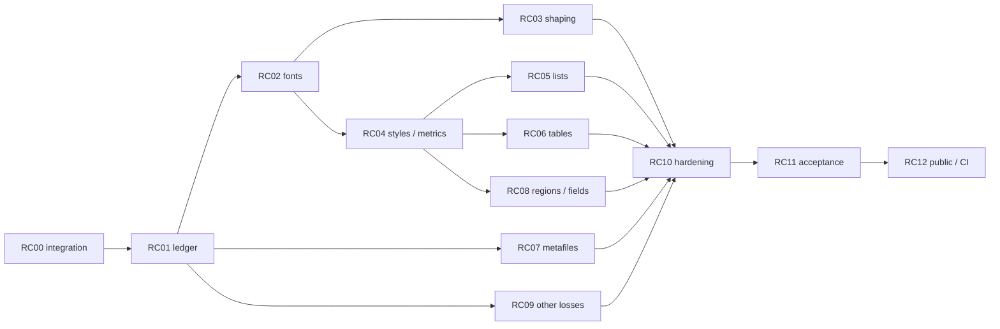

# План оставшейся совместимости RTF

Дата: 7 октября 2026. Историческая база RTF: `a7b3c9f`, ветка `codex/rtf-import`.
Текущий интеграционный baseline: ветка `codex/rtf-import-integrated`, HEAD `1c14d0b0`; подробности и ограничения — в [RC00_INTEGRATION.md](RC00_INTEGRATION.md).
Карточки остаются планом; RC00/RC01 частично закрыты, RC02 начат. Таблица ниже — исторический снимок 5 октября и не описывает новый прогон.
## Цель и исходное состояние

Цель — закрыть совместимость пользовательского корпуса из 100 RTF по содержимому,
структуре и отображению через публичный импорт. Приёмка поддержанного профиля
R07 и интеграция R08 рассматриваются отдельно. Наличие документированного
unsupported элемента позволяет объяснить Degraded, но не закрывает полную
совместимость документа с этим элементом.

Основание: [ACCEPTANCE.md](ACCEPTANCE.md),
[acceptance.development.json](acceptance.development.json),
[структурные probes](structure.wps-comparison.json).
Полная очередь документов: [compatibility.backlog.json](compatibility.backlog.json).

| Проверка снимка `a7b3c9f` | Результат |
| --- | --- |
| Import / exact body text / text+media roundtrip | 100/100 |
| Media parts, сохранённые побайтно | 38 |
| Strict XSD / OPC | 100/100, 0 violations |
| Пагинация WPS | 61 Pass, 39 Fail |
| Pixel gate документов | 2 Pass, 98 Fail |
| Страницы с установленным соответствием | 244; 7 Pass, 237 Fail |
| PDF report | 48 Clean, 52 Degraded |
| `pdf.font.missing` | 47 документов, 53 различных labels family |
| `pdf.font.no_glyph` | 6 документов |
| `pdf.image.unsupported` | 3 документа: 001, 004, 006 |

Категории пересекаются: 50 документов имеют font/glyph diagnostics, 52 — хотя бы
одну из трёх PDF diagnostics. У 28 из 39 pagination failures есть
`pdf.font.missing`; это корреляция, а не доказательство причины. Все 100 import
reports остаются Degraded. Body equality не проверяет notes/comments/revisions.

Два pixel PASS (040, 046) сохраняются как положительные controls; они не означают
полную совместимость всех свойств этих документов.

## Общие контракты и правила

Источники RTF и raw WPS references неизменяемы. Каждая карточка получает минимальный
synthetic fixture, независимый reference, воспроизводимый RED, исправление,
GREEN и отрицательный контроль. Изменения serialization сравниваются по смыслу
с разрешением IDs/relationships; отсутствующее свойство не считается равным
выведенному по догадке. WPS quirk отделяется от корректного сохранения RTF.

Базовые gates сохраняются: знаменатель 100, точный текст, hashes media,
Strict/OPC, CLI 0/1/2, отсутствие silent loss, bounded reports. Нельзя автоматически
назначать observed FAIL ожидаемым результатом, отключать неизвестные schema
violations, улучшать SSIM resizing/blur или повышением порога допустимой ошибки.

Новый render contract должен включать diagnostics SVG/layout, а не только PDF.
Clean возможен только при выполнении заявленного mapping/coverage. Фактический
fallback получает Degraded и provenance даже при визуально похожем результате.

Runtime строит WML и использует единые writer/renderers. WPS остаётся oracle;
не вводится конвертация через офисное приложение, OCR или PDF в runtime.
Для сложных конструкций расширяется общая модель с проверками всех потребителей;
скрытые XML fragments не подменяют недостающий контракт.

## Интеграция с другими работами

Основной checkout на момент интеграции: `ac51b68`. RTF-интеграция собрана отдельной историей поверх него; цепочка и конфликты описаны в [RC00_INTEGRATION.md](RC00_INTEGRATION.md). Интегрированная база содержит shaping и shared resolved faces вместе с существующими P5 run/paragraph metrics и P6 table widths. Статусы другого корпуса не принимаются за доказательство RTF совместимости.

Граф `D-projects-StrictLib` относится к основному checkout, а не RTF worktree. Для существовавших файлов graph coverage показал изменившиеся метаданные; новые RTF файлы в индексе отсутствовали. Поэтому текущие выводы проверялись непосредственно по исходникам и тестам.

Работа ведётся в отдельном worktree `C:\Users\gamer\.codex\worktrees\rtf-import-integrated\StrictLib`. RC00 включал только зафиксированные RTF изменения; незакоммиченные файлы иных очередей не переносились. Изменения общих model/font/layout/writer контрактов требуют согласованной единой реализации. Коммиты остаются в отдельной ветке и не означают merge в основную ветку.
## Очередь и зависимости

| ID | Приоритет | Пакет / область ответственности | Зависимости |
| --- | --- | --- | --- |
| RC00 | P0 | Интеграция и новый baseline; manifests, shared core/render/write | — |
| RC01 | P0 | Точная диагностика и ledger; PDF report, RTF harness/oracles | RC00 |
| RC02 | P0 | Единое разрешение fonts; shared font code и PDF embedding; associated-script mapping | RC00, RC01 |
| RC03 | P1 | Complex shaping, bidi, glyph clusters; renderer + RTF language mapping | RC02 |
| RC04 | P1 | Styles и paragraph/run geometry; RTF mapping + shared P5 | RC01, RC02 |
| RC05 | P1 | Numbering/lists; RTF lists, WML numbering, writer/layout | RC04 |
| RC06 | P1 | Tables; RTF builder + shared P6/layout/writer | RC04 |
| RC07 | P1 | WMF/EMF и picture properties; shared media/render pipeline | RC00, RC01 |
| RC08 | P1 | Sections/regions/notes/fields; RTF + WML/reader/writer/layout | RC01, RC04 |
| RC09 | P2 | Остальные loss classes; RTF mapping и необходимые shared types | RC01; RC08 для fields/revisions |
| RC10 | P1 | Hostile/resource/determinism gates; все новые декодеры и builders | Каждый реализованный RC02–RC09 |
| RC11 | P1 | Corpus/profile acceptance; independent facts, thresholds, receipts | RC02–RC10 |
| RC12 | P1 | Public feature matrix, CI и release integration | RC11 |

### RC00 — интеграция и воспроизводимый baseline

Сначала сравнить уже закрытые shared changes с RTF исправлениями: core pipeline,
list writer ordering, PDF CIDSystemInfo/CMap/FontBBox/aliases, model props,
resolved faces, shaping и DrawingML geometry. Для каждого совпадения определить
единственную реализацию и сохранить regression tests. Интеграцию делать отдельным
пакетом, сохраняя историю RTF; новые renderer fixes не писать поверх старой базы.

Артефакты текущего частичного baseline и команды приведены в [RC00_INTEGRATION.md](RC00_INTEGRATION.md). Public import для 100 источников, точный текст, целостность выходов, resource supervision, Strict XSD и OPC проверены после интеграции. Body/region facts, media roundtrip, render/pagination, pixels и feature matrix по-прежнему требуют повторного прогона. WPS recapture нужен только при изменении oracle contract, а не при изменении кода.

Статус: частично выполнено. Согласованные shared contracts и зафиксированные RTF fixes интегрированы; проверенные gates не показывают регрессий. Повторный visual snapshot текущей ветки: 62/100 pagination Pass, 3/100 pixel Pass; это development measurements, не полный baseline/acceptance.
### RC01 — диагностический ledger без ложных причин

Первичная интеграционная ошибка исправлена в `8e612a8`: PDF renderer теперь
различает отсутствующее семейство и отсутствующий glyph; тест на U+10FFFD
проверяет `pdf.font.no_glyph` без ложного `pdf.font.missing`. Добавлен per-feature
счётчик с bounded map (4096 имён, до 128 UTF-8 bytes каждое) и unattributed
overflow totals. Текущий [rc01-loss-ledger.json](rc01-loss-ledger.json) обновлён
после `5fe4988`:
523,927 Loss, 95 Info, 460 feature names; суммы сходятся по каждому файлу. До
RC02 было 1,327,900 Loss/459 features; `\\ab`, `\\ai`, `\\afs` сняли ровно
350,991 событий; mapping определённых `\\af` снял ещё 274,969, а 48 ссылок на
несуществующие definitions получили точные `undefined-font:*` labels. Mapping
`\\lang`/`\\langnp` и `\\langfe`/`\\langfenp` снизил остаток ещё на 178,013 Loss,
сохранив неизвестные LCID как явные Loss. У семи документов
усечён только retained detail stream; feature counters не усечены. Namespace
`control:*` теперь даёт 574,535 loss events. Подтверждён общий parser fallback для
unhandled control words (`parser.rs:2494`), но влияние каждого слова на вывод ещё
не установлено. Ранжирование ledger задаёт triage, а не диагноз. Backlog остаётся
unreviewed.

Собрать все import loss classes из полных totals/streams, включая записи сверх
cap. Для каждого класса: mapping owner, реальные witness IDs, неизвестная причина,
проверяемая гипотеза и минимальный fixture. Раздельно хранить confirmed diagnosis,
WPS-only quirk и unsupported contract. Уточнить facts sections, styles/defaults,
list restarts, tables/merges, regions, custom marks и поля вне inline модели.

Статус: частично выполнено — totals и наблюдаемые feature streams записаны; точная пофайловая семантическая классификация остаётся открытой. Закрытие: все 100 документов учтены, все обнаруженные loss classes имеют владельца,
missing glyph не выдаётся за missing face, mutations каждого нового fact group
обнаруживаются независимо. Ledger классифицирует работу, но не утверждает exceptions.

### RC02 — associated-script formatting, реальные fonts и единый resolved face

Частично обработаны `\\ab`, `\\ai` и `\\afs`: они хранятся в существующих
WML run fields `bCs`, `iCs`, `szCs`. `\\af` разрешается в East Asian font slot,
отдельно от обычного `\\f`; font switch, group state и import → write → reopen
закреплены fixture. В корпусе эти mappings сняли 625,960 generic Loss событий,
сохранив 100/100 text и resource gates; 48 отсутствующих font definitions
продолжают честно выдавать Loss. `\\lang`/`\\langnp` заполняют основной language
slot, `\\langfe`/`\\langfenp` — `eastAsia`; неизвестные LCID остаются явными
Loss. Regression покрывает group scope и import → write → reopen. В корпусе
осталось 523,927 Loss при 100/100 text/resource Pass. Pagination — 62/100,
pixels — 3/100; ни один page count или PDF hash не изменился после language
mapping. Это не полная визуальная приёмка. Следующие controls для triage:
`\\loch`, `\\hich`, `\\dbch`, `\\fcs`. Font registry, единый resolved face и
embedding остаются открытой частью RC02.

Использовать shared face/shaping API после RC00. Определить один resolved face
для measurement, glyph coverage, SVG emission и PDF subset: font SHA-256, face
index, variation coordinates, weight/slant и mapping provenance. Font assets
принимаются явным manifest; default остаётся deterministic bundled provider.
Локальные fonts используются только как явно выбранные, зафиксированные assets,
а не через неявный поиск по машине. Runtime API принимает owned/shared font bytes.

Новый контракт: optional font-assets registry по умолчанию отсутствует; текущий
builtin путь остаётся доступен. Missing-resource policy по умолчанию
ReportAndContinue, строгая policy — Reject. Registry key включает hash, face index
и variation coordinates, а не только family. Existing `ResolvedFace` main содержит
`&static` bytes/family и является Copy: для загружаемых assets нужен отдельный
owned handle и compatibility adapter; незаметно заменить lifetime нельзя.
`FontProvider` с одними metrics/advance не может быть единственным источником
embedding bytes. Этот shared API утверждается в RC02 до изменения потребителей.

Требуются три явно различимых результата: exact face, documented substitute,
unresolved face/glyph. По умолчанию unresolved сохраняет отчёт Degraded; строгий
профиль отклоняет такой render. Substitute не становится exact по близкому SSIM.
Права embedding и availability assets фиксируются до добавления в distributable
bundle; недоступный asset остаётся конкретным блокером, а не обещанием загрузить его.

Первые свидетели: 002 Futura/Garamond, 003/017 Georgia, 020/033 LucidaGrande,
007 Sanskrit 2003, 011 Vijaya, 018 Amar Bangla Normal. Для WPS отдельно установить
фактический resolved face: requested name в DOCX и installed-font inventory сами
по себе этого не доказывают. Проверить aliases, styled PostScript names, symbol/CJK,
missing glyph, reproducibility и font hashes. Не объявлять точность для 53 labels
без проверки: часть исходных labels относится к ошибочной диагностике RC01.

Закрытие: ни один заявленный поддержанным run не теряет glyph/text; faces и metrics
согласованы во всех backend, PDF Unicode extraction совпадает с logical text,
SVG переносит нужные faces, повторный запуск даёт одинаковые результаты.
Шесть уже исправленных alias документов остаются regression controls.

### RC03 — shaping и двунаправленный текст

Сначала использовать существующий harfrust/cluster pipeline main; не создавать
второй shaper для RTF. Проверить language/script/rtl/font slots из RTF, порядок
logical/visual clusters, combining marks, GSUB/GPOS, glyph offsets и границы
переноса. PDF должен сохранять Unicode clusters, а не только одиночные glyph IDs.

Свидетели: 007 Sanskrit, 010 Arabic, 011 Tamil, 018 Bengali; synthetic mixed
LTR/RTL с цифрами и punctuation, ligatures, combining sequences и non-BMP.
References должны измерять glyph origins/advances и подтверждать extracted text.

Закрытие: независимый cluster/geometry oracle и Unicode extraction проходят
для каждого заявленного script; отсутствие перестановки текста, разрывов clusters
и ложного Clean. Для оставшегося script — отдельная открытая карточка.

### RC04 — styles и геометрия текста

Зафиксировать cascade: document defaults → paragraph style/inheritance → character
style → direct properties; отдельно проверять явный false, plain/pard, cs slots,
language, fonts, half-points, character scale/spacing, tabs/leaders, auto/exact/
at-least spacing, keep/widow rules, hidden text и section defaults.
Общие исправления metrics брать из P5, а RTF очередь отвечает за mapping и witnesses.

Начать со style/spacing/tabs probes и 019/039 (одинаковое число страниц при pixel
FAIL), затем 052/076 и остальные документированные paragraph/layout failures.
Сходный page count не снимает ошибок line origins и paragraph placement.

Закрытие: независимые effective-style facts и line/paragraph geometry совпадают
на выбранных probes, units/defaults не угадываются, targeted pixels проходят,
ранее закрытый текст/roundtrip остаются 100/100.

### RC05 — списки и numbering

Разобрать restart/start override, level overrides, counter continuity между
параграфами/таблицами/секциями, marker fonts, suffix/tab/space, indentation и
legacy list constructs по ledger. Отрицательный list ID сохранять как корректную
source identity; случай, где WPS теряет numbering, проверять отдельно по спецификации
и второму независимому reader, а не имитировать потерю.

Закрытие: marker values/sequence/geometry и numbering XML проходят independent
facts, Strict XSD и reopen; нет двойного cached list text или потерянного restart.
Fixtures охватывают legal forward refs, missing abstracts, overrides и limits.

### RC06 — таблицы

RTF queue проверяет row/cell mapping, repeated definitions, grid, horizontal/
vertical merge, padding, alignment, widths, borders/shading, row heights,
header rows, nesting и разрывы страниц. Shared table geometry и units брать из P6.
Nested table support добавлять через bounded WML builder; до реализации явно Reject,
не flatten без loss. Свидетели определяются ledger, плюс existing vertical_merge
probe с уже подтверждёнными grid/text и fixtures mixed merged cells.

Закрытие: независимые grid/merge regions, cell text и widths совпадают;
renderer не дублирует/не теряет cells, page breaks воспроизводимы, resource bounds
сохраняются. Нельзя закрыть таблицу только совпадением concatenated text.

### RC07 — WMF/EMF и свойства изображений

Первый набор: 001, 004, 006 и portable positive/hostile fixtures. Сохранённый
payload/extent — исходный control, не доказательство rendering. Выбрать общий
bounded record decoder в typed vector primitives, используемый SVG и PDF;
растеризация допускается отдельной явно отмеченной policy с фиксированным DPI.

Проверить placeable/standard WMF, EMF coordinate transforms, object handles,
SaveDC/RestoreDC, clipping, strokes/fills/text, scaling/crop и bitmap records.
Каждый реально используемый record получает implement/test/disposition; неизвестный
влияющий record даёт Degraded/Reject, не success placeholder.
При неизвестном state-changing record отклоняется отрисовка соответствующего
picture с отчётом: нельзя пропустить команду и продолжить с недостоверным DC state.
Предлагаемые стартовые ceilings: 100000 records, 4096 live handles, 64 saved DC;
decoded bitmap bytes ≤ `max_single_uncompressed`. Это новые defaults для проверки,
а не утверждение о текущем коде; уменьшать/уточнять их по fixtures и корпусу.

Закрытие: оригинальные media bytes сохраняются, reference geometry и pixels
совпадают в обоих backend; malformed lengths/overflow/handles/records/decode bombs
отклоняются до allocation и не обходят import/render budgets.

### RC08 — секции, регионы, примечания и сложные поля

Проверить section inheritance/reset, margins/header/footer distances, columns,
first/even/odd regions, page numbering, note placement/numbering и ссылки.
Свойства из региона не должны менять body. Для custom mark сохранять glyph,
положение, формат и связь с note; unpaired marker не становится автоматической ссылкой.

Для multi-paragraph/nested fields сначала выбрать общий WML контракт с boundary
markers или block result; нынешний `Field.inlines` не представляет block result.
Reader/writer/layout/edit/report должны поддержать контракт до включения mapping.
Preserve instruction + cached result, bookmarks/hyperlink targets и relationships;
пересчёт динамических полей — отдельная явная функция, не скрытый импортный эффект.

Свидетели: regions/field_paragraphs probes, 003/015, 002 с несколькими секциями,
052 и synthetic custom notes/columns/links. Закрытие: exact region text/refs,
instructions/targets/geometry, Strict/OPC и reopen; отсутствие flatten с ложным Clean.

### RC09 — остальные классы потерь

По RC01 разложить comments, revisions, textboxes/shapes, OLE, metadata и прочие
controls на mapping tasks с witnesses. Использовать существующие WML revision/
DrawingML types, проверяя final/original view и семантику сохранения. OLE сохраняется
как opaque payload/relationships без activation; preview измеряется отдельно.
Сохраняемые авторство/даты/документные свойства не считать визуальными glyph losses,
но потерю этих данных по-прежнему показывать в import report.

Закрытие: у каждого наблюдаемого класса есть implemented semantics и independent
roundtrip test либо явное неподдержанное правило с открытым compatibility status.
Последнее достаточно для честного supported profile, но не закрывает полную цель
по документу, использующему этот класс. Blanket ignore/rename-to-info запрещён.

### RC10 — hardening и границы ресурсов

Выполняется вместе с каждым новым decoder/builder, не откладывается до конца.
Проверить debug/release hostile inputs, budgets fonts/media/records/nodes/clusters,
time/memory, cycles/forward refs, issue cap и точные totals. Нужны controls на
abort/write failure и неизменность источника. Fuzz targets имеют фиксированный seed,
corpus и time budget, crash artifacts не выдаются за successful documents.

Закрытие: ни одного panic/hang/silent fallback вне policy; import supervisor
30 s / 512 MiB и render 90 s / 1 GiB измерены на всех 100 файлах с достоверным
peak RSS. Новые публичные limits документированы и проверены на границах.

### RC11 — полная корпусная и профильная приёмка

Независимо review support matrix/expectations для всех 100 inputs: semantics,
oracle versions/hashes, fonts, expected outcome, resources и каждый допустимый Loss.
Не заполнять pending expectations из текущих failures. Структурные comparisons
проверяют эффективные свойства и все регионы, а не только выбранные style names.

Для полной corpus compatibility: 100/100 content/media/structure, 100/100 page
counts, все сопоставленные страницы проходят pixel/geometry policy, 0 silent loss,
0 unexpected/Blocked, 0 необъяснённых degradation. Известный WPS quirk с проверенной
RTF семантикой имеет отдельный reference и явный статус; общий WPS PASS тогда
не заявляется. Word compatibility не объявляется на основании WPS capture.

Действующий development pixel threshold SSIM 0.96 и structural bounds не ослаблять.
До acceptance закрепить reviewed profile/threshold version и независимые positive/
negative controls. Неполная font availability или unresolved renderer/model feature
блокирует соответствующую полную приёмку; не удалять строку из знаменателя.

Закрытие: свежий source/feature/font/oracle/binary receipt, 100 verdicts, все page
metrics, tests и воспроизводимый clean checkout. R07 supported-profile release
может быть отдельным результатом с перечисленными ограничениями, но не названием
для незакрытой полной corpus compatibility.

### RC12 — публичная интеграция и CI

Проверить no-default/base, rtf-only, default, all-features и relevant platform
combinations; CLI status/reports, viewer diagnostics, source/media/font lifetime.
Portable synthetic fixtures входят в CI на Windows/Linux/macOS без WPS.
Полный локальный корпус и WPS references запускаются воспроизводимым отдельным
acceptance job с asset/oracle access; их отсутствие означает NotRun/Blocked.

Закрытие: current-SHA CI подтверждён, existing shared queues не регрессировали,
100 inputs проходят публичный путь, frontend показывает resolved/substitute/
unsupported statuses и подробный report. Включённый workflow без успешного run
не является доказательством. Merge/release — отдельные завершающие операции
после готового reviewable diff и проверок.

## Порядок исполнения и артефакты

Первая итерация: RC00 → RC01 → RC02. Затем RC03/RC04; RC07 можно вести независимо
после общей диагностики. После RC04 идут lists/tables/regions; RC09 закрывается
по semantic impact. Любая параллельная работа требует отдельных paths/владельцев
и общего integration contract; shared `parser.rs`, model и layout не имеют двух
независимых авторов одновременно.

Для карточки: `docs/rtf/compatibility/RCxx/{STATUS.json,tests.md,witnesses.json}`,
ignored raw artifacts `target/rtf-import/compatibility/RCxx/`. Receipt фиксирует
точный commit/tree/dirty diff, options, commands/exit codes, resource/font/oracle
hashes и до/после каждого witness. Status: Planned → InProgress → Verified;
Blocked содержит конкретный отсутствующий asset/contract, а не истёкший срок.

Срок полной совместимости уточняется после RC00–RC02: нынешние 97 pixel failures
ещё не разбиты на доказанные root causes. План не даёт календарного обещания
до интеграции новой базы и установления реально используемых fonts.
